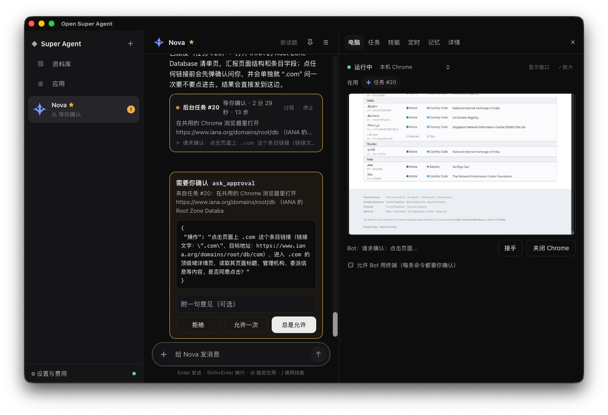
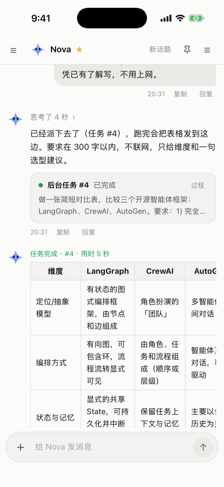

<div align="center">

# open-super-agent

**A self-hosted, always-on AI teammate that chats, delegates work, and has a computer you can watch and take over.**

An open-source alternative to [Grok Bot](https://x.ai/bot). Bring your own model and pay per token.

[](https://github.com/kadaliao/open-super-agent/actions/workflows/ci.yml)
[](LICENSE)


[简体中文](README.md) · English

<a href="docs/images/demo.mp4"></a>

<sub>Group handoff → teach a task → library (model wait times sped up) · <a href="docs/images/demo.mp4">HD MP4</a></sub>

</div>

## Highlights

- **Chats and delegates**: each Bot has its own persona, memory and conversation. Long jobs run as background tasks while you keep chatting; put several Bots in a group, and one hands its research to another to write up.
- **A computer you can watch and take over**: Bots browse, fill in forms and download files on the computer while you watch live; for captchas and logins, they ask you to step in. Several tasks run at once, each in its own browser window, without queueing.
- **Connects to the apps you use**: 40 apps in the market, including Notion, Gmail, GitHub, Feishu, DingTalk and Tencent Docs, connected with a login or a token; any MCP server works too.
- **Asks before acting**: sending mail, submitting forms and similar actions show a card first; secrets are encrypted in a vault and never enter the chat.
- **Any model, with visible cost**: DeepSeek, Kimi, Zhipu, OpenAI, Ollama on your own machine, or any OpenAI-compatible endpoint. Spend is tracked per task and per day, with a daily budget.
- **Show it once**: with Teach a task, do the job yourself on the computer and the Bot turns it into a skill you run again with `/name`; say "every day at 9, ..." to set up a routine.
- **Works in mainland China**: talk to your Bots in Feishu, DingTalk or WeCom; the default setup needs no paid foreign service; the UI comes in Chinese and English.
- **Your data stays yours**: it runs on your own machine, and all data, secrets included, exports as one encrypted file you can carry to another machine.

See [Features](docs/features.en.md) for the full list.

## Where you use it

| Client | What you get |
|---|---|
| 💻 **macOS desktop app** (preview) | Download the dmg and open it: about 42 MB with its own runtime, no Docker or Python; Bots use the Chrome on your computer. It keeps running in the menu bar after you close the window, and can also connect to your server. See [Desktop app](docs/desktop.md) (Chinese) |
| 🖥️ **Server** | One `docker compose up` on a VPS or a machine at home keeps it always on; connect from a browser, the desktop app, your phone or a chat app. See [Deploy with Docker Compose](docs/docker.md) (Chinese) |
| 📱 **iPhone app** (in development) | Scan a QR code on your computer with the Camera to connect; approvals and finished tasks are pushed to your phone, encrypted, and readable on the lock screen. See [iPhone app](docs/mobile.md) (Chinese) |
| 💬 **Chat apps** | Talk to your Bots from Telegram, Feishu/Lark, DingTalk, WeCom or Discord, with approvals as message buttons. See [Chat apps](docs/channels.md) (Chinese) |

<p align="center">
  
</p>
<p align="center">
  
  
  
  
</p>
<p align="center"><sub>Top: the macOS desktop app. Bottom: the iPhone app (in development): chat · background task · approval · the Bot's computer. Screenshots show the Chinese UI.</sub></p>

OpenMausBot, a similar project, makes different trade-offs; see [Compared with OpenMausBot](docs/comparison.en.md).

## Quick start

On a Mac, the quickest way is the **desktop app** (preview): download the dmg for your chip from the [releases page](https://github.com/kadaliao/open-super-agent/releases), open it and choose "Run on this computer".

To keep it always on a server, use Docker Compose; you only need Docker:

```bash
git clone https://github.com/kadaliao/open-super-agent.git && cd open-super-agent
cp .env.example .env     # optionally fill in DEEPSEEK_API_KEY, or add a key later in Settings → Models
docker compose up -d     # the first build takes 5–10 minutes; then open http://127.0.0.1:8765
```

The first time you open it, a short setup guide walks you through adding a model provider, meeting your Bot (or installing one from a template) and connecting an app.
See [Deploy with Docker Compose](docs/docker.md) (Chinese) for automatic HTTPS, using Instabox as the computer, and backups.

<details>
<summary>Run without Docker</summary>

You need Python ≥ 3.11 with [uv](https://docs.astral.sh/uv/) and Node ≥ 20 (plus Docker for the local Docker computer; not needed with Instabox or your local Chrome):

```bash
export DEEPSEEK_API_KEY=sk-...              # optional, you can also add it in Settings → Models; see .env.example
(cd web && npm ci && npm run build)
uv run uvicorn osa.server:app --port 8765   # open http://127.0.0.1:8765
```

</details>

> [!WARNING]
> Login is off by default, so run it on localhost or a private network such as Tailscale. To put it on the public internet, set `OSA_PASSWORD` to turn on login and serve it over HTTPS. See [SECURITY.md](SECURITY.md).

## Documentation

[Features](docs/features.en.md) and [the comparison](docs/comparison.en.md) are in English; the other docs are in Chinese for now:

- [Deploy with Docker Compose](docs/docker.md)
- [Configuration](docs/configuration.md): models, limits and prices, the computer, apps, approvals and the vault, routines, push, remote access
- [Desktop app (preview)](docs/desktop.md): running on your computer or connecting to your server
- [iPhone app (in development)](docs/mobile.md): QR pairing, how pushes reach the phone, what the push relay can see, development
- [Chat apps](docs/channels.md): connecting Telegram, Feishu/Lark, DingTalk, WeCom and Discord
- [Adding an app to the market](docs/apps.md)
- [Writing a Bot template](docs/templates.md)
- [Architecture](docs/architecture.md)
- [Development](docs/development.md)
- [Roadmap](docs/roadmap.md): what comes next; finished plans are in [docs/plans](docs/plans/)
- [Changelog](CHANGELOG.md)
- [Security](SECURITY.md)

## Roadmap

- **Clients**: a stable macOS desktop app; the iPhone app on TestFlight first; then Windows and Android; using the bot in chat-app group chats.
- **Computers**: whole-desktop control (not just the browser); letting Bots on a server borrow the browser on your computer; snapshots and rollback.
- **App ecosystem**: new apps and Bot templates mostly come from community PRs; the project fills gaps in the manifest format and connection methods.
- **Bot abilities**: voice conversations.

The reasoning and priorities are in [docs/roadmap.md](docs/roadmap.md) (Chinese). Feature requests are welcome as issues.

## Contributing

Issues and PRs are welcome; please read [CONTRIBUTING.md](CONTRIBUTING.md) (Chinese) first.

## Acknowledgements

- DeepSeek Super-agent (October 2026 tech blog): the Router / Worker / Watchdog / Inline & Spill architecture
- [Grok Bot](https://x.ai/bot): the product shape and interaction model
- [Instabox](https://instabox.sh), [noVNC](https://github.com/novnc/noVNC), [Model Context Protocol](https://modelcontextprotocol.io), [Tauri](https://tauri.app)

## License

[MIT](LICENSE) © Kada Liao
