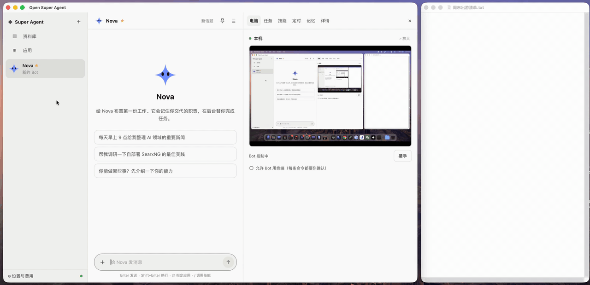

<div align="center">

# open-super-agent

**A self-hosted, always-on AI teammate that chats, delegates work, and has a computer you can watch and take over.**

An open-source alternative to [Grok Bot](https://x.ai/bot). Bring your own model and pay per token.

[](https://github.com/kadaliao/open-super-agent/actions/workflows/ci.yml)
[](LICENSE)


[简体中文](README.md) · English

<a href="docs/images/demo.mp4"></a>

<sub>Group handoff → teach a task → library (model wait times sped up) · <a href="docs/images/demo.mp4">HD MP4</a></sub>

</div>

## Features

- 🤖 **Multiple bots**: each with its own name, avatar, persona and conversation. Replies stream in, and the model's reasoning can be expanded or collapsed.
- 👥 **Group chats**: 2–6 Bots in one chat. `@` a Bot to have it answer, or `@everyone`; unaddressed messages go to the group's coordinator, who hands work to the right Bot. Bots hand off to each other (one researches, the next summarizes when the research is done). Approval requests stay in each Bot's private chat.
- ✉️ **Bots message each other**: no group needed. A Bot can DM another Bot for help ("ask Postman whether there's mail from Anthropic"); the other Bot works in its own chat, and the result comes back to the original conversation automatically.
- ⚡ **Background tasks**: workers run long jobs while you keep chatting. **Heavy mode** runs several workers on the same problem and has a reviewer merge their answers.
- 🖥️ **A computer**: one shared Linux desktop with Chromium and a terminal. Web pages are driven directly over CDP (by element, reading page text), which is fast and precise. Watch it live and take over or hand back at any time; for captchas and logins, the bot asks you to step in.
- 🔌 **App market**: pick apps from the sidebar's Apps page. Notion, flomo, Tencent Docs, DingTalk, TickTick, Todoist and others connect with one click and an account login; Gmail, QQ Mail, Feishu, WeCom and GitHub take a single password, token or link; Slack takes a small app you create once; any MCP server works too. Mention one in chat with `@app`. Each app is a single manifest file, so [listing a new one](docs/apps.md) takes a PR, no code.
- ✅ **Approvals & vault**: write operations ask first (allow once / deny / always allow), with rules you manage in Settings; secrets are stored encrypted and never enter the chat.
- 🧩 **Skills**: reusable procedures invoked with `/name`. Ask a Bot to save what it just did as a skill, or edit skills in the side panel. With **Teach a task**, do it once yourself on the computer and the Bot turns the recording into a draft skill for you to review. Export a skill as a file or share it by link, and others install it by pasting the link; `SKILL.md` files from Claude and similar tools import as is.
- 🎁 **Bot templates**: start a new Bot from a ready-made template (news digest, inbox helper, GitHub watcher, trip planner) with skills and routines already set up. Turn a Bot you've tuned into a template and share it; [write one](docs/templates.md) (Chinese) and open a PR to make it built in.
- 🧠 **Memory**: each Bot remembers your preferences and the work it has done; basic facts about you (name, time zone) are shared by all Bots. Just say "remember ...", or view, edit, delete and import (e.g. from ChatGPT) in the side panel. Start a **new topic** to drop old messages from the context while keeping memories. Memories and the library are searchable by meaning, and Bots look up past notes and pages on their own.
- 📚 **Library**: finished reports and web pages are saved as Pages you can pin and share by link; browse, upload and download files on the shared computer, and attach files in chat.
- ⏰ **Routines**: per-Bot schedules (daily / weekdays, every N minutes, webhook) with pause, resume, test and the last 20 runs. Create one by saying "every day at 9, ...". Webhook events go through keyword filters, then a cheap model decides whether to act.
- 💬 **Chat apps**: talk to your Bots from Telegram, Feishu/Lark, DingTalk, WeCom or Discord, in the same conversation as the web UI. Approval requests arrive as buttons, and you can send files (and voice messages on DingTalk and WeCom). No public address needed ([setup guide](docs/channels.md), Chinese).
- 📱 **Mobile**: install it to your home screen as an app, dictate messages by voice, and get push notifications for approvals and finished tasks when no page is open. Watch the screen, take over and type, and handle approvals from your phone.
- 💰 **Transparent cost**: token and money tracking per role, task and day, with a daily budget. A watchdog cancels tasks that stall, loop or exceed the budget.
- 📦 **Backup and migration**: export all data, secrets included, as one encrypted file and upload it on the new machine to carry on. Servers can also back up on a schedule from the command line.
- 🔄 **Any model**: add model providers in Settings (DeepSeek, OpenAI, OpenRouter, SiliconFlow, Alibaba Bailian, Zhipu, Kimi, Ollama, or any OpenAI-compatible endpoint), paste an API key and test it in one click; pick a model per role. Prices are fetched automatically.

The architecture follows DeepSeek's Super-agent design: a Router that converses, Workers that execute, and a Watchdog that supervises.

## Quick start

With Docker Compose you only need Docker:

```bash
git clone https://github.com/kadaliao/open-super-agent.git && cd open-super-agent
cp .env.example .env     # optionally fill in DEEPSEEK_API_KEY, or add a key later in Settings → Models
docker compose up -d     # the first build takes 5–10 minutes; then open http://127.0.0.1:8765
```

The first time you open it, a short setup guide walks you through adding a model provider, meeting your Bot (or installing one from a template) and connecting an app.

See [Deploy with Docker Compose](docs/docker.md) (in Chinese) for automatic HTTPS, using Instabox as the computer, and backups.

Without Docker you need Python ≥ 3.11 with [uv](https://docs.astral.sh/uv/) and Node ≥ 20 (plus Docker for the local computer backend):

```bash
export DEEPSEEK_API_KEY=sk-...              # optional, you can also add it in Settings → Models; see .env.example
(cd web && npm ci && npm run build)
uv run uvicorn osa.server:app --port 8765   # open http://127.0.0.1:8765
```

> [!WARNING]
> Login is off by default, so run it on localhost or a private network such as Tailscale. To put it on the public internet, set `OSA_PASSWORD` to turn on login and serve it over HTTPS. See [SECURITY.md](SECURITY.md).

## Documentation

The detailed docs are currently in Chinese:

- [Deploy with Docker Compose](docs/docker.md)
- [Configuration](docs/configuration.md)
- [Architecture](docs/architecture.md)
- [Development](docs/development.md)
- [Chat apps](docs/channels.md): connecting Telegram, Feishu/Lark, DingTalk, WeCom and Discord
- [Adding an app to the market](docs/apps.md)
- [Writing a Bot template](docs/templates.md)
- [Roadmap](docs/roadmap.md): what comes next ([the Grok Bot parity plan](docs/grok-bot-parity.md) is archived)
- [Changelog](CHANGELOG.md)

## Roadmap

Everything needed to match Grok Bot shipped in v0.3.0 (see the [changelog](CHANGELOG.md)). Where it goes next:

- **App ecosystem**: new apps and Bot templates mostly come from community PRs; the project fills gaps in the manifest format and connection methods.
- **More clients**: macOS and Windows desktop apps (menu bar, hotkeys, system notifications, and letting a Bot use your own computer); native iOS and Android apps; using the bot in chat-app group chats.
- **Computers**: several computers running tasks in parallel; Teach a task across the whole desktop, not just the browser; snapshots and rollback.
- **Bot abilities**: voice conversations.
- **Easier to deploy and use**: an English UI.

The reasoning and priorities are in [docs/roadmap.md](docs/roadmap.md) (Chinese). Feature requests are welcome as issues.

## License

[MIT](LICENSE) © Kada Liao
