<div align="center">

# open-super-agent

**A self-hosted, always-on AI teammate that chats, delegates work, and has a computer you can watch and take over.**

An open-source alternative to [Grok Bot](https://x.ai/bot). Bring your own model and pay per token.

[](https://github.com/kadaliao/open-super-agent/actions/workflows/ci.yml)
[](LICENSE)


[简体中文](README.md) · English

<a href="docs/images/promo.mp4">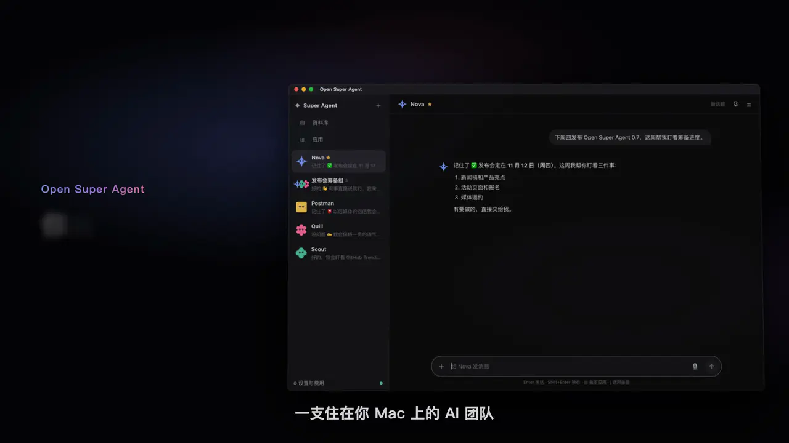</a>

<sub>Feature tour (silent, sped up; Chinese UI): link cards · threads · background tasks · the Bot's computer · ask first · groups · Bot DMs · drawing · schedules · apps · skills · memory · costs · <a href="docs/images/promo.mp4">full 2-minute promo (Chinese voice-over)</a></sub>

<sub>Recorded on 2026-11-08 (v0.7.0). Added since: events, the Insights page, video generation, searching posts on X, Reddit and Xiaohongshu, sending tasks to your Mac, the Requests board, and tasks you can keep talking to. <a href="#a-look-around">New screenshots below</a>. Get the latest version from the <a href="https://github.com/kadaliao/open-super-agent/releases/latest">releases page</a>; see the <a href="CHANGELOG.md">changelog</a> (Chinese) for every release.</sub>

</div>

## Highlights

- **Chats and delegates**: each Bot has its own persona, memory and conversation. Long jobs run as background tasks while you keep chatting, and you can see every step; add a word halfway through, get asked when it's unsure, reply to a finished task to keep it going, and it carries on after a server restart. Put several Bots in a group, and one hands its research to another to write up.
- **Everything you asked for, in one place**: each request is a card on the Requests board, in To do, In progress, Needs you or Done, decided by the tasks behind it; cards belong to numbered projects (`OPC-12`), and what you ask for in chat becomes a card on its own. Memory tidies itself up every night: expired notes stop being used, duplicates are merged, and you can undo it.
- **A computer you can watch and take over**: Bots browse, fill in forms and download files on the computer while you watch live; for captchas and logins, they ask you to step in. Several tasks run at once, each in its own browser window, without queueing.
  The computer can be the Bots' own, or simply your Mac: once you grant the permissions, they use the mouse and keyboard in apps like WeChat, Finder and Notes, and stop as soon as you move the mouse.
- **Finds what's new**: web search and page reading use free services by default, with no API key needed. They can also rotate across providers (DeepSeek, Exa, Tavily…), moving to the next when one fails, and say whose account pays when a paid one is in use; Bots can also search posts on X, Reddit and Xiaohongshu, with like and comment counts.
- **Connects to the apps you use**: 40 apps in the market, including Notion, Gmail, GitHub, Feishu, DingTalk and Tencent Docs, connected with a login or a token; any MCP server works too.
- **Writes documents with you**: edit documents in the library directly, select a passage, comment and @ a Bot, and it makes the change and replies in the thread; share a link and anyone can read it without logging in. The docs service comes with OSA, nothing extra to deploy.
- **Asks before acting**: sending mail, submitting forms and similar actions show a card first; secrets are encrypted in a vault and never enter the chat.
- **Any model, with visible cost**: DeepSeek, Kimi, Zhipu, OpenAI, Ollama on your own machine, or any OpenAI-compatible endpoint. The Insights page shows what you spent, how fast things ran and what went wrong, with a daily budget.
  Image drawing, editing from reference images and video generation are wired to providers through config.
- **Show it once, run it on time**: with Teach a task, do the job yourself on the computer and the Bot turns it into a [skill](docs/skills.md) you run again with `/name`. Skills can carry scripts and reference files, come ready-made from the skill market, or be imported from Claude's SKILL.md.
  Say "every day at 9, ..." to set up a routine, or "tell me when this page changes" to set up an [event](docs/events.md).
- **Works in mainland China, your data stays yours**: talk to your Bots in Feishu, DingTalk or WeCom; the default setup needs no paid foreign service; the UI comes in Chinese and English. It runs on your own machine, and all data, secrets included, exports as one encrypted file you can carry to another machine.

See [Features](docs/features.en.md) for the full list.

## A look around

<table>
<tr>
<td width="50%">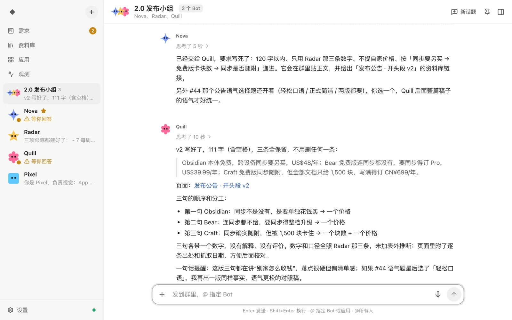<br><sub><b>Group work</b>: Nova assigns, Radar hands its competitor research to Quill, Quill writes the announcement opening into the library</sub></td>
<td width="50%">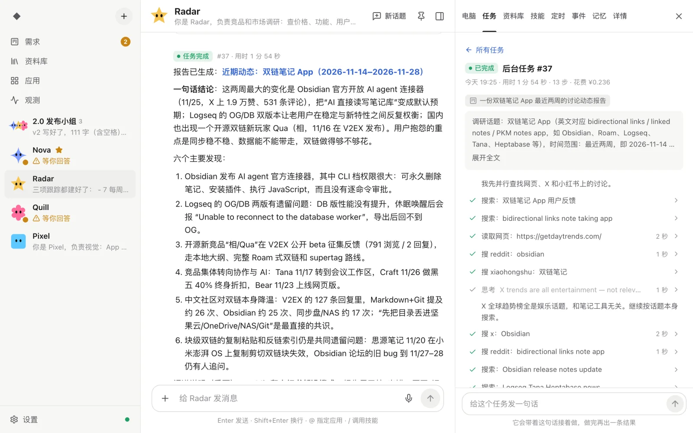<br><sub><b>Background task</b>: two weeks of discussion about note apps, with every step on the right (web search, X / Reddit / Xiaohongshu, reading pages)</sub></td>
</tr>
<tr>
<td width="50%">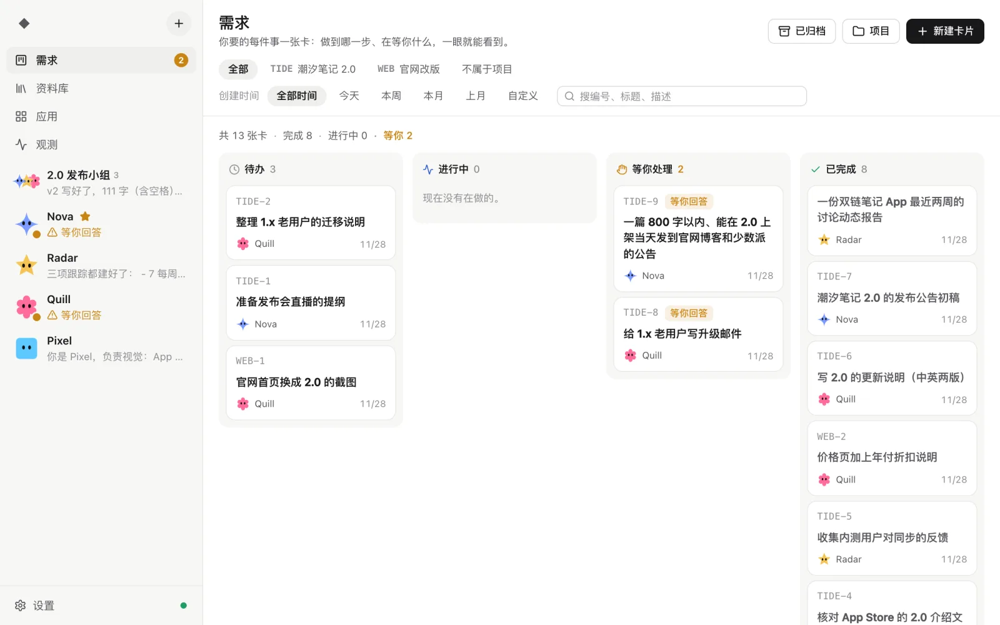<br><sub><b>Requests board</b>: one card per request, its column decided by the tasks behind it</sub></td>
<td width="50%">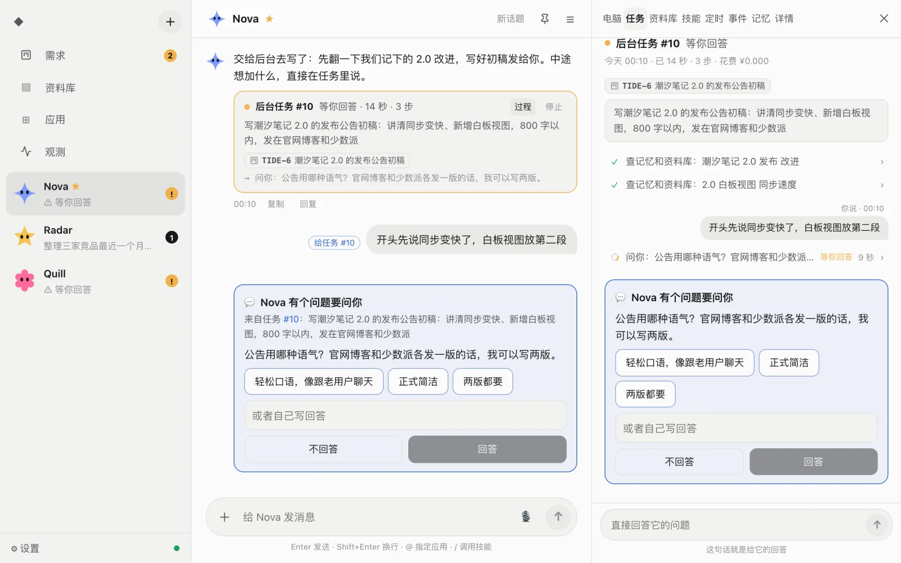<br><sub><b>Tasks you can talk to</b>: add a word halfway, and it stops to ask which tone you want</sub></td>
</tr>
<tr>
<td width="50%">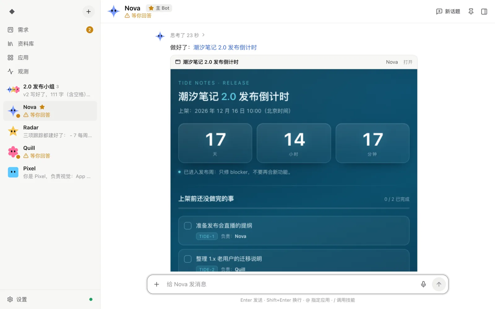<br><sub><b>Applet</b>: a launch countdown Nova built from one sentence</sub></td>
<td width="50%">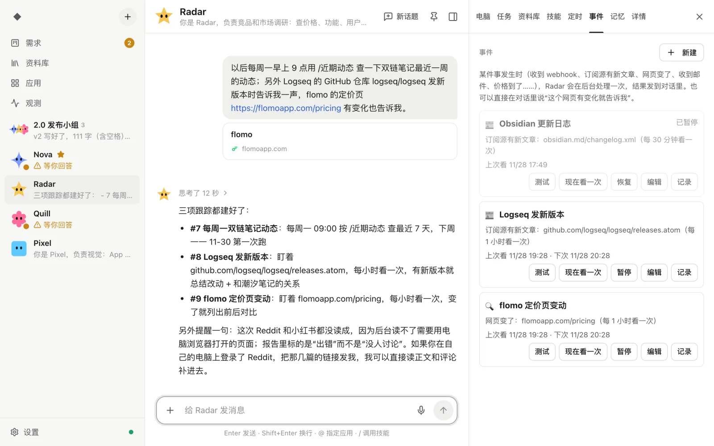<br><sub><b>Events</b>: Radar watching for a new release and a pricing page change, set up from one sentence</sub></td>
</tr>
<tr>
<td>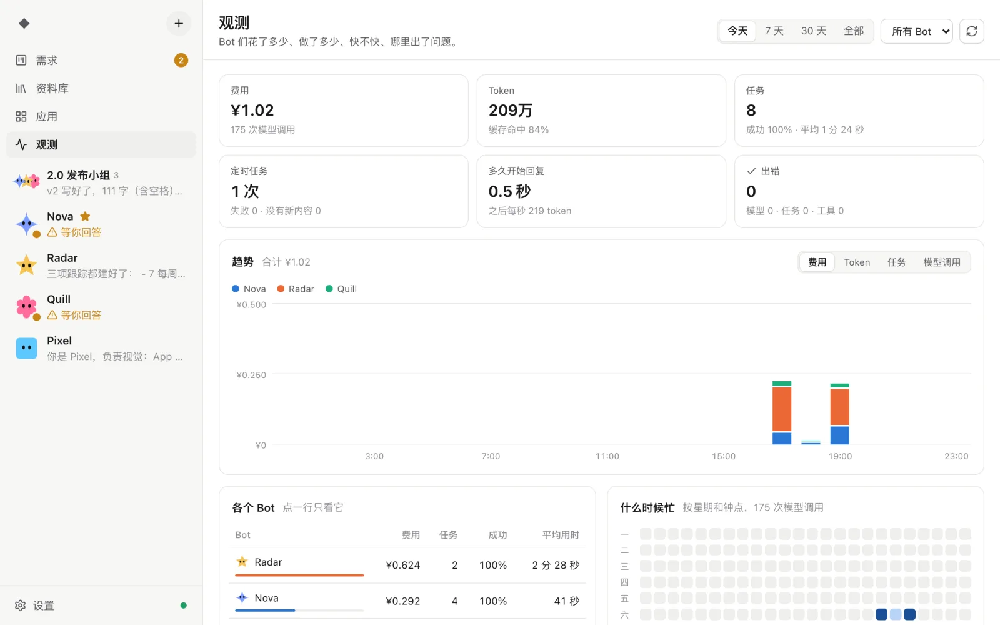<br><sub><b>Insights</b>: what you spent, how fast, what went wrong, per Bot if you like</sub></td>
<td>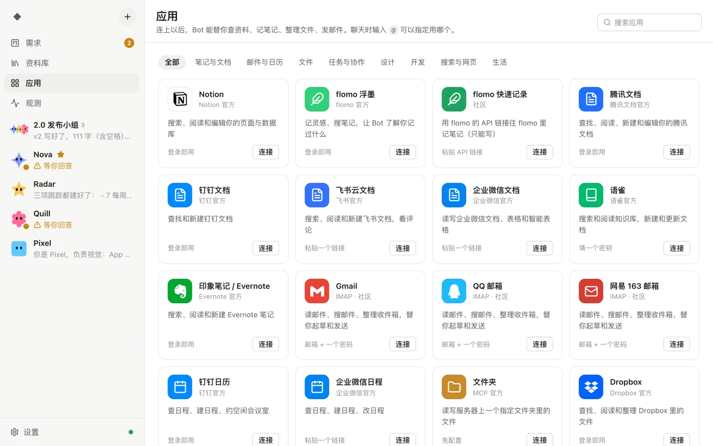<br><sub><b>App market</b>: 40 apps, connected with a login or a token</sub></td>
</tr>
</table>

<sub>Screenshots taken on 2026-11-16 (the v0.24.0 web UI, in Chinese) with demo data: an indie developer launching “Tidal Notes 2.0”. The three Bots and everything on the pages were produced by a real model (DeepSeek). The Requests board and task screenshots were taken on 2026-11-28 with a scripted demo conversation.</sub>

## Where you use it

| Client | What you get |
|---|---|
| 💻 **macOS desktop app** | Download the dmg and open it: about 40 MB with its own runtime, no Docker or Python. By default Bots use this computer: a browser, plus the screen, mouse and keyboard once you grant the permissions; you can switch to a Docker sandbox or a cloud computer. It keeps running in the menu bar after you close the window, and can also connect to your server, so the Bots there can send tasks that need your Mac to it. See [Desktop app](docs/desktop.md) (Chinese) |
| 🖥️ **Server** | One `docker compose up` on a VPS or a machine at home keeps it always on; connect from a browser, the desktop app, your phone or a chat app. See [Deploy with Docker Compose](docs/docker.md) (Chinese) |
| 📱 **iPhone app** (TestFlight) | Scan a QR code on your computer with the Camera to connect; approvals and finished tasks are pushed to your phone, encrypted, and readable on the lock screen. See [iPhone app](docs/mobile.md) (Chinese) |
| 💬 **Chat apps** | Talk to your Bots from Telegram, Feishu/Lark, DingTalk, WeCom or Discord, with approvals as message buttons. See [Chat apps](docs/channels.md) (Chinese) |

<p align="center">
  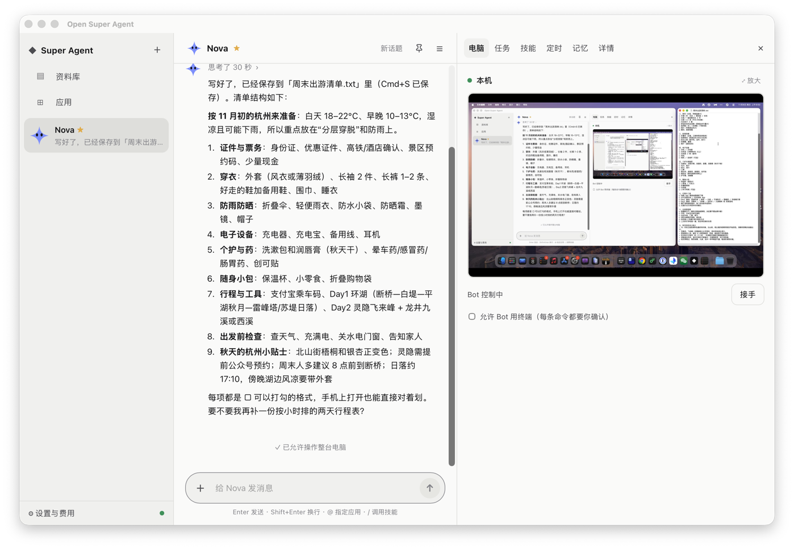
</p>
<p align="center">
  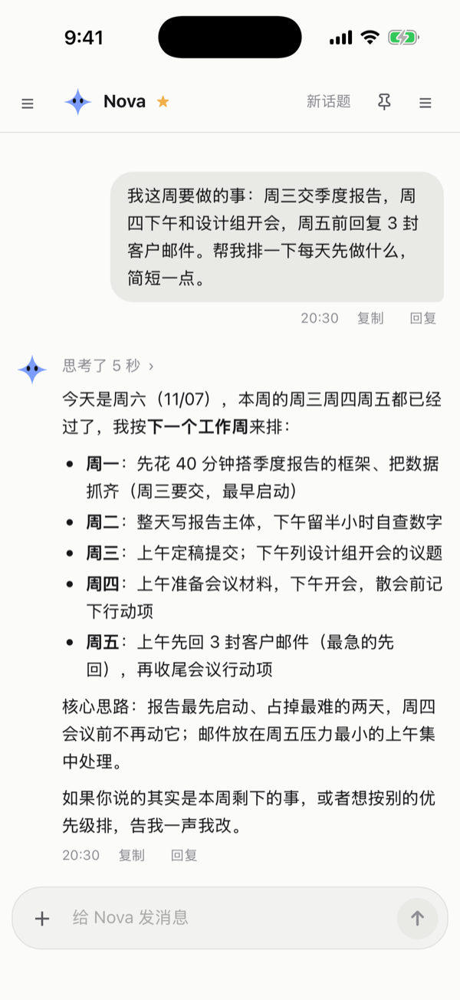
  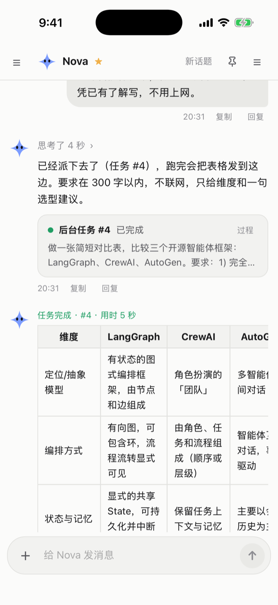
  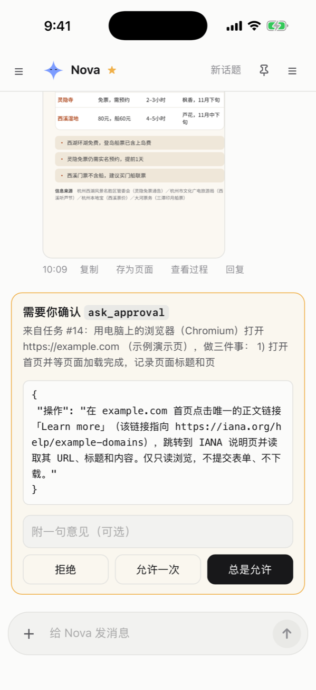
  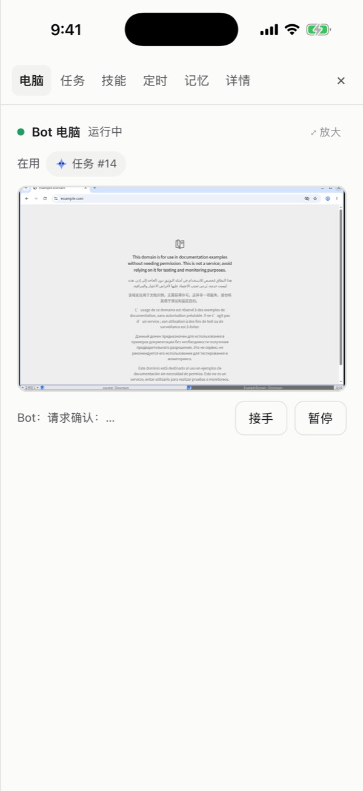
</p>
<p align="center"><sub>Top: the macOS desktop app (<a href="docs/images/mac-control.mp4">watch a Bot use the whole Mac</a>). Bottom: the iPhone app (TestFlight): chat · background task · approval · the Bot's computer. Screenshots show the Chinese UI.</sub></p>

OpenMausBot, a similar project, makes different trade-offs; see [Compared with OpenMausBot](docs/comparison.en.md).

## System requirements

Models run at the model provider, so no GPU is needed (running models locally with Ollama is extra). What you need depends mostly on where the Bots' computer lives:

| Setup | Minimum | Recommended | Disk |
|---|---|---|---|
| macOS desktop app, computer = this Mac | macOS 12, Apple silicon or Intel, 8 GB RAM | 16 GB RAM | app about 130 MB |
| Server, cloud computer (Instabox) | 1 core, 1 GB | 2 cores, 2 GB | 5 GB |
| Server, local Docker computer | 2 cores, 4 GB | 4 cores, 8 GB | 10 GB |

- The service itself takes about 110–170 MB of RAM, plus 20–60 MB for each app run with `npx` / `uvx`; the apps' npm and uv caches grow to about 1 GB.
- Docker computer: about 30 MB with an empty desktop, about 250 MB with one page open; three windows on heavy sites such as Bilibili and Taobao take about 0.9 GB and half a CPU core. The image is about 1.2 GB.
  On a small machine, set Settings → Limits & budget → "Tasks using the computer at once" to 1 or 2.
- The cloud computer runs on Instabox and uses none of your machine. For reference: on a 2-core, 2 GB VPS, the main service, the demo service and a few other services together use about 1 GB of RAM.
- Desktop app: the Bots' Chrome takes 200–400 MB per window. Choosing "Docker sandbox" in the app also needs Docker Desktop; 16 GB of RAM is recommended then.

Figures measured on v0.12 in November 2026.

## Quick start

On a Mac, the quickest way is the **desktop app**: download the dmg for your chip from the [releases page](https://github.com/kadaliao/open-super-agent/releases), or run `brew install --cask kadaliao/tap/open-super-agent`. Open it and choose "Run on this computer".

To keep it always on a server, use Docker Compose; you only need Docker:

```bash
git clone https://github.com/kadaliao/open-super-agent.git && cd open-super-agent
cp .env.example .env     # optionally fill in DEEPSEEK_API_KEY, or add a key later in Settings → Models
docker compose up -d     # the first build takes 5–10 minutes; then open http://127.0.0.1:8765
```

The first time you open it, a short setup guide walks you through adding a model provider, meeting your Bot (or installing one from a template) and connecting an app.
See [Deploy with Docker Compose](docs/docker.md) (Chinese) for automatic HTTPS, using Instabox as the computer, and backups.

<details>
<summary>Run without Docker</summary>

You need Python ≥ 3.11 with [uv](https://docs.astral.sh/uv/) and Node ≥ 20 (plus Docker for the local Docker computer; not needed with Instabox or this computer):

```bash
export DEEPSEEK_API_KEY=sk-...              # optional, you can also add it in Settings → Models; see .env.example
(cd web && npm ci && npm run build)
uv run uvicorn osa.server:app --port 8765   # open http://127.0.0.1:8765
```

</details>

> [!WARNING]
> Login is off by default, so run it on localhost or a private network such as Tailscale. To put it on the public internet, set `OSA_PASSWORD` to turn on login and serve it over HTTPS. See [SECURITY.md](SECURITY.md).

## Documentation

[Features](docs/features.en.md) and [the comparison](docs/comparison.en.md) are in English; the other docs are in Chinese for now:

- [Deploy with Docker Compose](docs/docker.md)
- [Configuration](docs/configuration.md): models, drawing and video generation, web search and reading, limits and prices, task retries and shutdown, the computer, apps, approvals and the vault, routines, push, memory tidy-up, the Requests board and projects, remote access
- [Events](docs/events.md): have a Bot act when something happens: webhooks, GitHub, feeds, page changes, mail, calendar, weather, earthquakes, prices, public IP…; addresses and security, writing a new source
- [Desktop app](docs/desktop.md): running on your computer or connecting to your server, and sending the server's tasks to this Mac
- [iPhone app (TestFlight)](docs/mobile.md): QR pairing, how pushes reach the phone, what the push relay can see, development
- [Chat apps](docs/channels.md): connecting Telegram, Feishu/Lark, DingTalk, WeCom and Discord
- [Adding an app to the market](docs/apps.md)
- [Writing a Bot template](docs/templates.md)
- [Skills](docs/skills.md): writing skills, packages with scripts and references, import, export and sharing, the skill market, compatibility with Claude's SKILL.md
- [Architecture](docs/architecture.md)
- [Development](docs/development.md)
- [Roadmap](docs/roadmap.md): what comes next; finished plans are in [docs/plans](docs/plans/)
- [Changelog](CHANGELOG.md)
- [Security](SECURITY.md)

## Roadmap

- **Clients**: a public iPhone beta, then the App Store; then Windows and Android; using the bot in chat-app group chats.
- **Computers**: whole-desktop control on Windows; snapshots and rollback.
- **App ecosystem**: new apps and Bot templates mostly come from community PRs; the project fills gaps in the manifest format and connection methods.
- **Bot abilities**: voice conversations.

The reasoning and priorities are in [docs/roadmap.md](docs/roadmap.md) (Chinese). Feature requests are welcome as issues.

## Contributing

Issues and PRs are welcome; please read [CONTRIBUTING.md](CONTRIBUTING.md) (Chinese) first.

## Acknowledgements

- DeepSeek Super-agent (October 2026 tech blog): the Router / Worker / Watchdog / Inline & Spill architecture
- [Grok Bot](https://x.ai/bot): the product shape and interaction model
- [Instabox](https://instabox.sh), [noVNC](https://github.com/novnc/noVNC), [Model Context Protocol](https://modelcontextprotocol.io), [Tauri](https://tauri.app)

## License

[MIT](LICENSE) © Kada Liao
