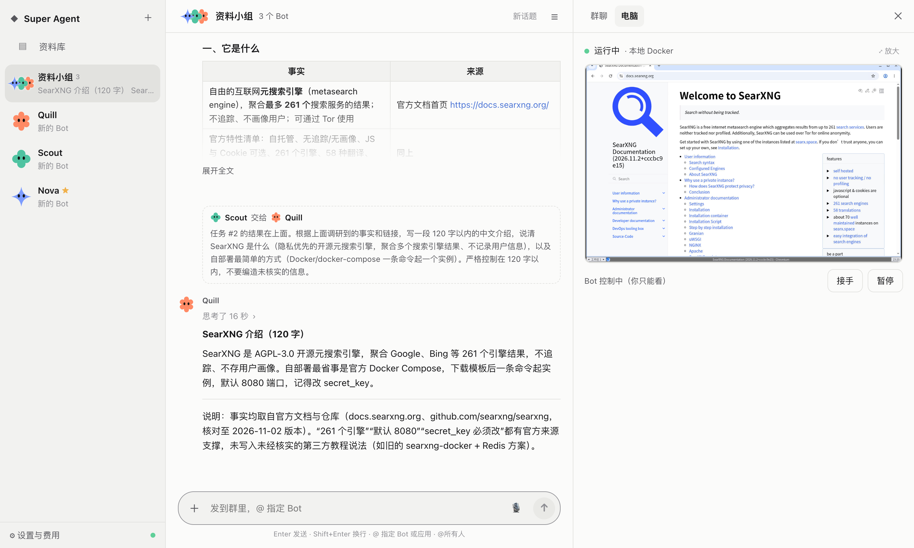

<div align="center">

# open-super-agent

**A self-hosted, always-on AI teammate that chats, delegates work, and has a computer you can watch and take over.**

An open-source alternative to [Grok Bot](https://x.ai/bot). Bring your own model and pay per token.

[](https://github.com/kadaliao/open-super-agent/actions/workflows/ci.yml)
[](LICENSE)


[简体中文](README.md) · English



</div>

## Features

- 🤖 **Multiple bots**: each with its own name, avatar, persona and conversation. Replies stream in, and the model's reasoning can be expanded or collapsed.
- ⚡ **Background tasks**: workers run long jobs while you keep chatting. **Heavy mode** runs several workers on the same problem and has a reviewer merge their answers.
- 🖥️ **A computer**: one shared Linux desktop with Chromium and a terminal. Web pages are driven directly over CDP (by element, reading page text), which is fast and precise. Watch it live and take over or hand back at any time; for captchas and logins, the bot asks you to step in.
- 🔌 **Apps via MCP**: connect the filesystem, GitHub, Notion and more from Settings; mention one in chat with `@app`.
- ✅ **Approvals & vault**: write operations ask first (allow once / deny / always allow), with rules you manage in Settings; secrets are stored encrypted and never enter the chat.
- 🧩 **Skills**: reusable procedures invoked with `/name`. Ask a Bot to save what it just did as a skill, or edit skills in the side panel.
- ⏰ **Routines**: per-Bot schedules (daily / weekdays, every N minutes, webhook) with pause, resume, test and the last 20 runs. Create one by saying "every day at 9, ...". Webhook events go through keyword filters, then a cheap model decides whether to act.
- 💰 **Transparent cost**: token and money tracking per role, task and day, with a daily budget. A watchdog cancels tasks that stall, loop or exceed the budget.
- 🔄 **Any model**: any OpenAI-compatible API (DeepSeek, OpenRouter, Ollama, vLLM), configurable per role.

The architecture follows DeepSeek's Super-agent design: a Router that converses, Workers that execute, and a Watchdog that supervises.

## Quick start

Requirements: Python ≥ 3.11 with [uv](https://docs.astral.sh/uv/), Node ≥ 20, and Docker (for the local computer backend).

```bash
git clone https://github.com/kadaliao/open-super-agent.git && cd open-super-agent
export DEEPSEEK_API_KEY=sk-...              # see .env.example for all variables
(cd web && npm ci && npm run build)
uv run uvicorn osa.server:app --port 8765   # open http://127.0.0.1:8765
```

> [!WARNING]
> There is no authentication yet. Run it on localhost or a private network such as Tailscale only. See [SECURITY.md](SECURITY.md).

## Documentation

The detailed docs are currently in Chinese:

- [Configuration](docs/configuration.md)
- [Architecture](docs/architecture.md)
- [Development](docs/development.md)
- [Roadmap](docs/roadmap.md)
- [Changelog](CHANGELOG.md)

## Roadmap

- [x] P1 Bots & chat
- [x] P2 Computer (Instabox and local Docker backends, live view, takeover, task queueing)
- [x] P3 Approval rules, app management, a vault and `@app` mentions; browser control over CDP
- [x] P4 Skills & routines
- [ ] P5 Memory & library
- [ ] P6 Group chat
- [ ] P7 Teach-a-task & mobile

## License

[MIT](LICENSE) © Kada Liao
