<div align="center">

# open-super-agent

**可以自己部署的常驻 AI 队友：会聊天，会派活，还有一台能看、能接手的电脑。**

开源，可替代 [Grok Bot](https://x.ai/bot)。模型自选，按 token 计费。

[](https://github.com/kadaliao/open-super-agent/actions/workflows/ci.yml)
[](LICENSE)


简体中文 · [English](README.en.md)

<a href="docs/images/promo.mp4">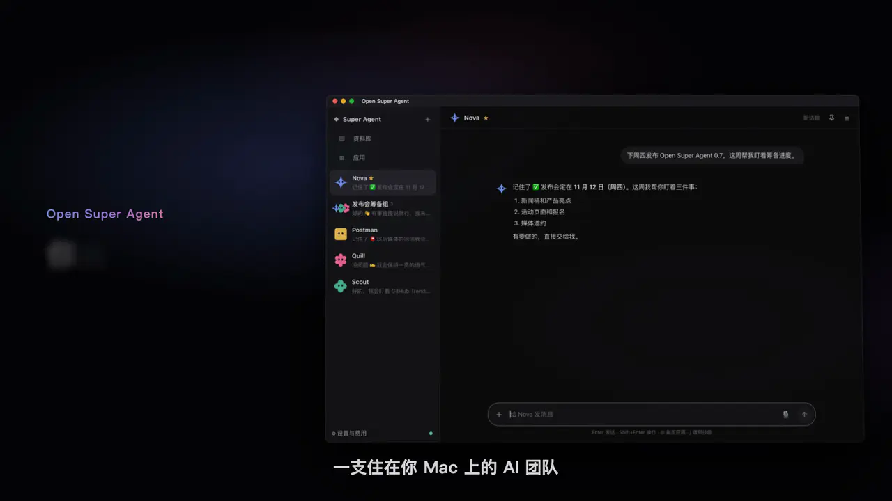</a>

<sub>功能一览（无声，已加速）：链接卡片 · 讨论串 · 后台任务 · Bot 的电脑 · 先问再做 · 群聊 · Bot 私信 · 画图 · 定时任务 · 应用 · 技能 · 记忆 · 费用 · <a href="docs/images/promo.mp4">看完整宣传片（2 分钟，有配音）</a></sub>

<sub>录于 2026-11-08（v0.7.0）。之后加的主要有：事件、观测页、生成视频、搜 X / Reddit / 小红书的帖子、把任务派到你的 Mac、需求看板、能接着说的任务。<a href="#看看长什么样">新截图在下面</a>。最新版本见 <a href="https://github.com/kadaliao/open-super-agent/releases/latest">发布页</a>，每一版的变化见 <a href="CHANGELOG.md">更新日志</a>。</sub>

</div>

## 亮点

- **会聊天，也会派活**：每个 Bot 有自己的人设、记忆和对话。耗时的活交给后台任务，你接着聊，每一步做了什么都看得到；做到一半能补一句，拿不准时它停下来问你，做完回一句就接着做，服务重启了也接着做。几个 Bot 能拉群，一个查完资料，自动交给另一个写总结。
- **交代过的事一眼看到**：你要的每件事一张卡，在“需求”看板上按待办、进行中、等你处理、已完成排好，在哪一列由背后的任务决定；卡片归到项目下、带编号（`OPC-12`），对话里交代的事自动成卡。记忆每天夜里自己整理：过期的不再带进对话，重复的合并，不满意能撤销。
- **一台能看、能接手的电脑**：Bot 在电脑上查资料、填表、下载文件，你能实时看屏幕；遇到验证码、登录这类步骤，它请你来做。几个任务同时做，各开一个浏览器窗口，不用排队。
  电脑可以是 Bot 自己的，也可以就是你的 Mac：给了权限，它能用鼠标键盘操作微信、访达、备忘录这些 App，你一动鼠标它就停下。
- **查得到最新的**：搜网页、读网页默认走免费的服务，不用填 API Key；也能换着用几家（DeepSeek、Exa、Tavily……），一家不行换下一家，用到收费的会写明钱从哪扣；还能搜 X、Reddit、小红书上的帖子，带点赞和评论数。
- **连上你在用的应用**：应用市场收录了 40 个，Notion、Gmail、GitHub、飞书、钉钉、腾讯文档……登录或填 token 就能接，也能接任意 MCP。
- **和 Bot 一起写文档**：资料库里的文档你直接编辑，选中一段评论、@ 某个 Bot，它就来改、在评论里回你；生成一个链接就能给别人看，不用登录。文档服务装 OSA 时就带着，不用另外部署。
- **先问再做**：发邮件、提交表单这类操作先弹卡片问你；密钥加密存在保险库里，不进聊天记录。
- **模型随便换，花多少看得到**：DeepSeek、Kimi、智谱、OpenAI、本机的 Ollama，任何兼容 OpenAI 的接口都行。“观测”页里看花了多少、做得快不快、哪里出了错，有每日预算。
  画图、照着图片改图、生成视频也按配置接各家。
- **教一遍就会，到点就做**：点“演示一遍”，在电脑上亲手做一次，Bot 把操作整理成[技能](docs/skills.md)，以后输入 `/名字` 就能重做；技能能带脚本和参考资料，也能从技能市场装现成的、导入 Claude 的 SKILL.md。
  说“每天 9 点帮我……”就建好定时任务，说“这个网页有变化就告诉我”就建好[事件](docs/events.md)。
- **在国内好用，数据在你手里**：在飞书、钉钉、企业微信里直接和 Bot 说话；默认配置不需要国外的付费服务；界面有中文和英文。跑在你自己的机器上，全部数据（连同密钥）能导出成一个加密文件，换台机器接着用。

完整的功能见 [功能一览](docs/features.md)。

## 看看长什么样

<table>
<tr>
<td width="50%">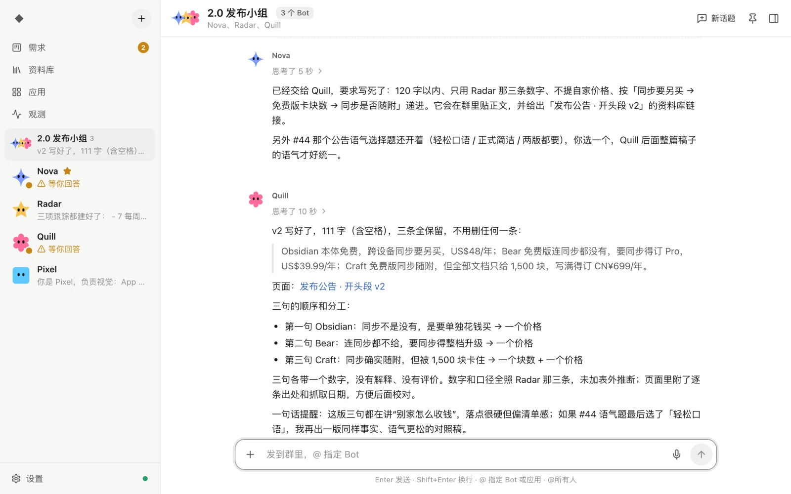<br><sub><b>群聊分工</b>：Nova 派活，Radar 挑出竞品数字，Quill 把公告开头写进资料库</sub></td>
<td width="50%">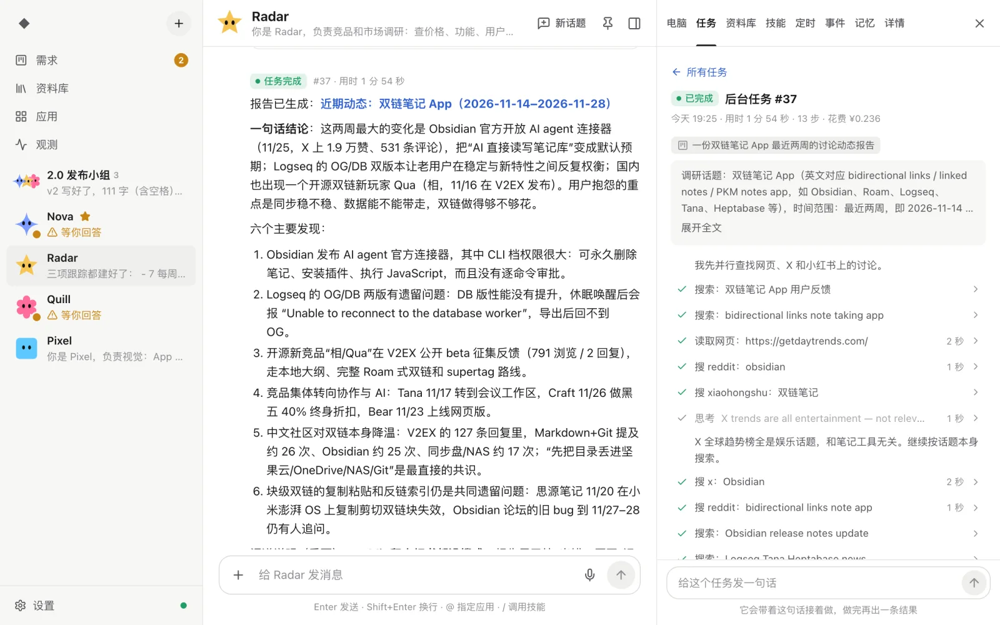<br><sub><b>后台任务</b>：查“双链笔记”最近两周的讨论，右栏是每一步（搜网页、搜 X / Reddit / 小红书、读网页）</sub></td>
</tr>
<tr>
<td width="50%">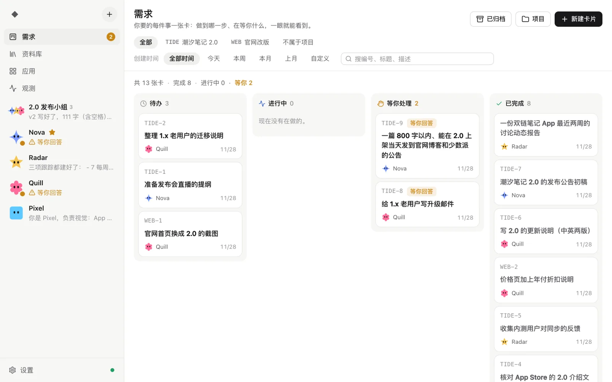<br><sub><b>需求看板</b>：每件事一张卡，在哪一列由背后的任务决定</sub></td>
<td width="50%">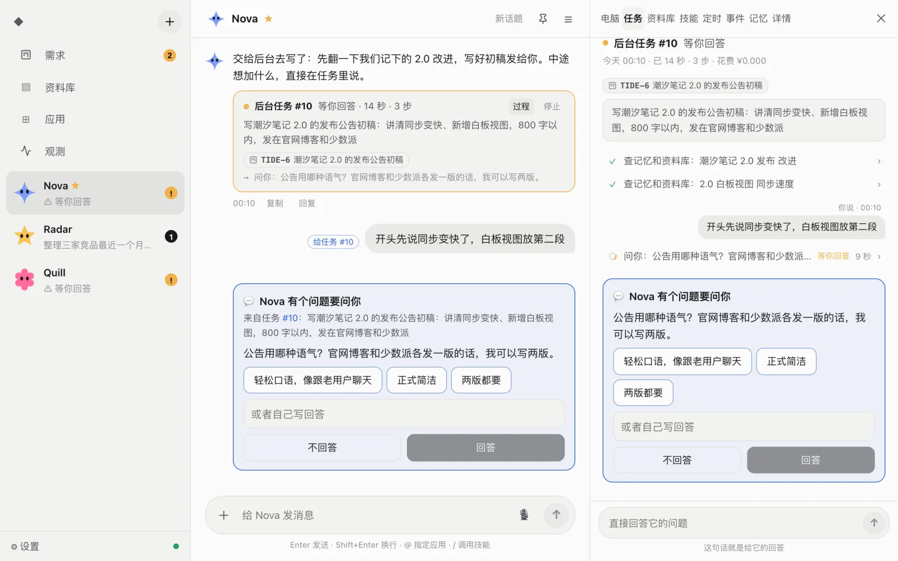<br><sub><b>任务能对话</b>：中途补一句，它停下来问你用哪种语气</sub></td>
</tr>
<tr>
<td width="50%">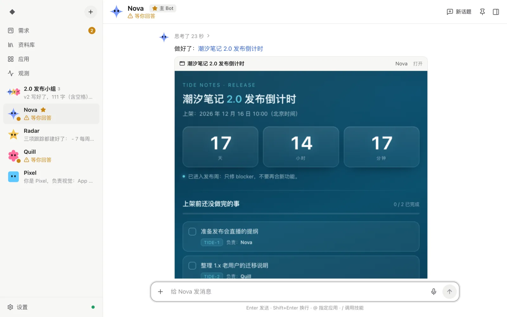<br><sub><b>小应用</b>：一句话让 Nova 做的发布倒计时</sub></td>
<td width="50%">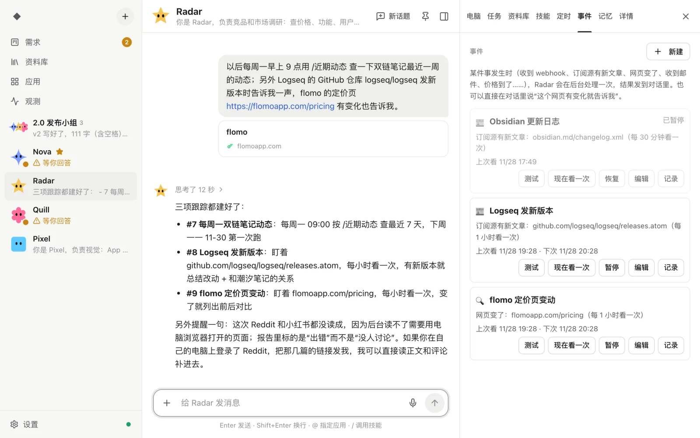<br><sub><b>事件</b>：一句话让 Radar 盯着新版本发布和定价页变化</sub></td>
</tr>
<tr>
<td>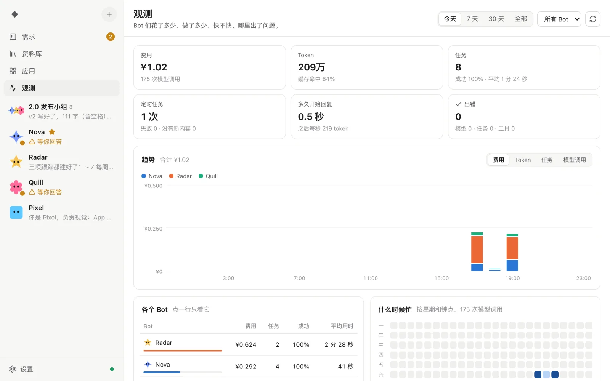<br><sub><b>观测</b>：花了多少、做得快不快、哪里出了错，能按 Bot 看</sub></td>
<td>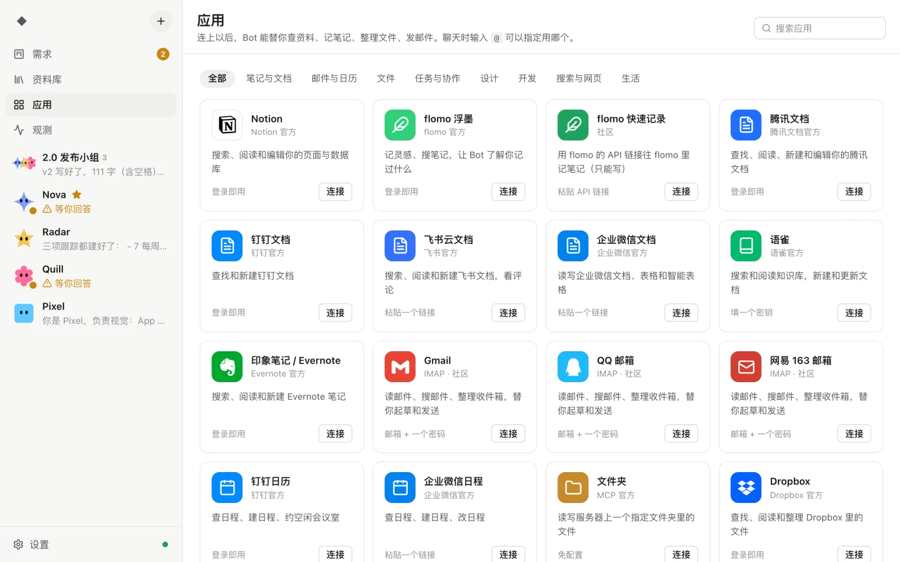<br><sub><b>应用市场</b>：40 个应用，登录或填 token 就能连</sub></td>
</tr>
</table>

<sub>截图录于 2026-11-28（v0.29.0 的网页界面），用的是演示数据：一个独立开发者准备发布“潮汐笔记 2.0”。你说的话是事先写好的，Bot 的回复、任务和页面里的内容都是真模型（DeepSeek）跑出来的。</sub>

## 在哪用

| 用法 | 说明 |
|---|---|
| 💻 **macOS 桌面 App** | 下载 dmg 打开就能用：约 40 MB，自带运行环境，不用装 Docker 和 Python。Bot 默认直接用这台电脑：浏览器，给了权限还有屏幕和鼠标键盘；也能换成 Docker 沙盒或云电脑。关掉窗口后在菜单栏接着跑；也能连到你的服务器，服务器上的 Bot 能把要在 Mac 上做的任务派过来。见 [桌面 App](docs/desktop.md) |
| 🖥️ **服务器** | 一条 `docker compose up` 放到 VPS 或家里的机器上，一直开着；浏览器、桌面 App、手机、聊天软件都能连。见 [用 Docker Compose 部署](docs/docker.md) |
| 📱 **iPhone App**（TestFlight 内测） | 用相机扫电脑上的二维码就连上；要你确认的事、做完的任务推送到手机，内容加密，锁屏上就能看。见 [iPhone App](docs/mobile.md) |
| 💬 **聊天软件** | 在 Telegram、飞书、钉钉、企业微信、Discord 里直接和 Bot 说话，要你确认的操作变成消息里的按钮。见 [聊天软件](docs/channels.md) |

<p align="center">
  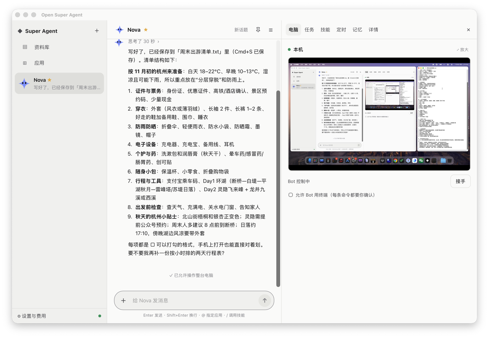
</p>
<p align="center">
  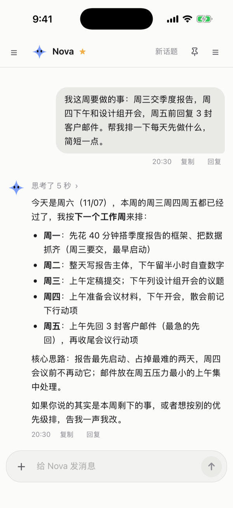
  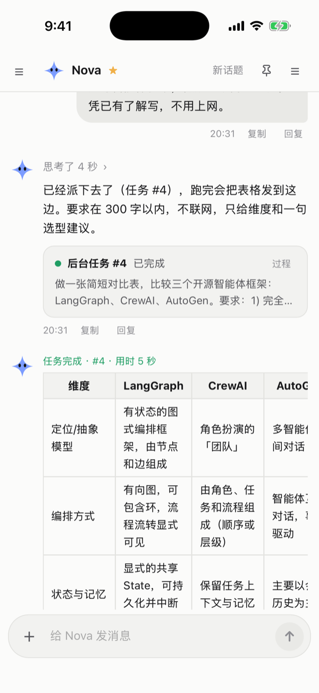
  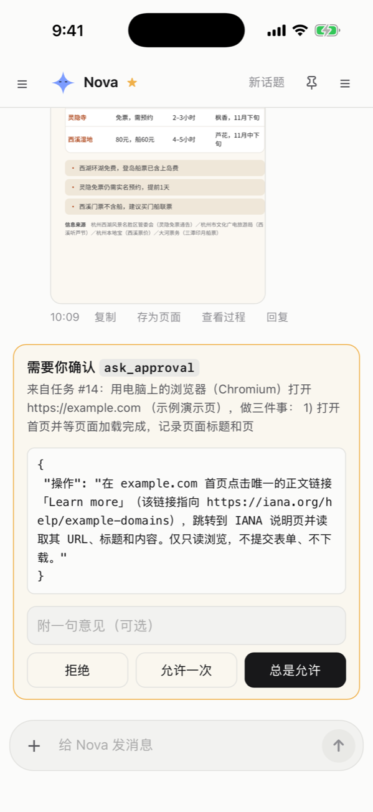
  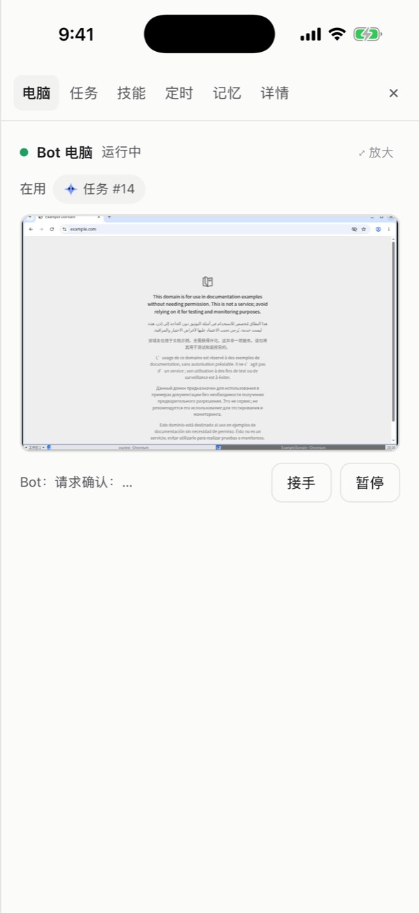
</p>
<p align="center"><sub>上：macOS 桌面 App（<a href="docs/images/mac-control.mp4">看 Bot 操作整台 Mac 的录屏</a>）。下：iPhone App（TestFlight 内测），对话 · 后台任务 · 确认卡片 · 看 Bot 的电脑</sub></p>

同类项目 OpenMausBot 的取舍不一样，见 [和 OpenMausBot 比](docs/comparison.md)。

## 系统要求

模型跑在模型服务那边，不需要显卡（用本机的 Ollama 跑模型另算）。要多少资源主要看 Bot 的电脑放在哪：

| 怎么用 | 最低 | 建议 | 硬盘 |
|---|---|---|---|
| macOS 桌面 App，电脑用本机 | macOS 12，Apple 芯片或 Intel，8 GB 内存 | 16 GB 内存 | App 约 130 MB |
| 服务器，电脑用云电脑（Instabox） | 1 核 1 GB | 2 核 2 GB | 5 GB |
| 服务器，电脑用本地 Docker | 2 核 4 GB | 4 核 8 GB | 10 GB |

- 服务本身约占 110–170 MB 内存，每个用 `npx` / `uvx` 跑的应用另占 20–60 MB；应用的 npm、uv 缓存会长到 1 GB 左右。
- Docker 电脑：空桌面约 30 MB，开一个网页约 250 MB；三个窗口同时开着 B 站、淘宝这类页面约 0.9 GB 内存、半个 CPU 核；镜像约 1.2 GB。
  机器小就把 设置 → 限制与预算 →“同时用电脑的任务”调成 1 或 2。
- 云电脑跑在 Instabox 上，不占你的机器。作为参考：一台 2 核 2 GB 的 VPS 上，正式服务、演示服务和另外几个服务加起来用了约 1 GB 内存。
- 桌面 App：Bot 的 Chrome 每个窗口 200–400 MB。在 App 里选“Docker 沙盒”还要装 Docker Desktop，这时建议 16 GB 内存。

以上是 2026 年 11 月在 v0.12 上实测的数字。

## 快速开始

在 Mac 上最快的办法是装**桌面 App**：到 [发布页](https://github.com/kadaliao/open-super-agent/releases) 下载对应芯片的 dmg，或者 `brew install --cask kadaliao/tap/open-super-agent`，打开后选“在这台电脑上运行”。

放到服务器上一直开着，用 Docker Compose，只需要装 Docker：

```bash
git clone https://github.com/kadaliao/open-super-agent.git && cd open-super-agent
cp .env.example .env     # 可以先填上 DEEPSEEK_API_KEY，也可以打开后在 设置 → 模型 里填
docker compose up -d     # 第一次要构建镜像，大约 5–10 分钟；打开 http://127.0.0.1:8765
```

第一次打开会有引导：接上一个模型服务、认识你的 Bot（或从模板装一个）、连一个常用应用，三步就能开始用。
自动 HTTPS、电脑改用 Instabox、国内镜像源、备份，见 [用 Docker Compose 部署](docs/docker.md)。

<details>
<summary>不用 Docker 运行</summary>

需要 Python ≥ 3.11 和 [uv](https://docs.astral.sh/uv/)、Node ≥ 20；本地 Docker 电脑仍要 Docker（用 Instabox 或本机时不需要，见 [配置 → 电脑](docs/configuration.md#电脑)）。

```bash
export DEEPSEEK_API_KEY=sk-...              # 可选，也可以打开后在 设置 → 模型 里填；环境变量一览见 .env.example
(cd web && npm ci && npm run build)         # 构建前端
uv run uvicorn osa.server:app --port 8765   # 打开 http://127.0.0.1:8765
```

第一次用电脑时会自动构建本地镜像，需要几分钟。国内网络可以先手动构建，用镜像源加速：

```bash
docker build --build-arg APT_MIRROR=mirrors.ustc.edu.cn -t osa-computer:2 osa/computer/image
```

</details>

> [!WARNING]
> 默认**不用登录**，只能在本机或内网（例如 Tailscale）使用。要部署到公网，先设置 `OSA_PASSWORD` 打开登录，再用 HTTPS 访问，见 [配置 → 部署到公网服务器](docs/configuration.md#部署到公网服务器) 和 [SECURITY.md](SECURITY.md)。

## 文档

| 文档 | 内容 |
|---|---|
| [功能一览](docs/features.md) | 全部功能，按主题分组 |
| [用 Docker Compose 部署](docs/docker.md) | 一条命令跑起来、自动 HTTPS、数据和备份、国内网络 |
| [配置](docs/configuration.md) | 模型服务和各项工作用的模型、画图和生成视频、搜索和读网页、限额与单价、任务出错和停服务、电脑、应用、确认规则与保险库、定时任务、推送、记忆整理、需求看板和项目、远程访问 |
| [事件](docs/events.md) | 某件事发生时让 Bot 处理：webhook、GitHub、订阅源、网页变化、邮件、日程、天气、地震、价格、公网 IP……；地址和安全、写一个新来源 |
| [桌面 App](docs/desktop.md) | 在这台电脑上运行或连接服务器、把服务器上的任务派到这台 Mac、系统通知、菜单栏、自动更新 |
| [iPhone App（内测）](docs/mobile.md) | 扫码连接、推送怎么送到手机、推送中转看得到什么、开发 |
| [聊天软件](docs/channels.md) | 连接 Telegram、飞书、钉钉、企业微信、Discord，配对，权限和常见问题 |
| [给应用市场加应用](docs/apps.md) | 应用清单的格式、图标、在本机试、提 PR |
| [写一个 Bot 模板](docs/templates.md) | 模板的格式、从现有 Bot 导出、加进内置 |
| [技能](docs/skills.md) | 技能的写法、带脚本和参考资料的技能包、导入导出和分享、技能市场、和 Claude SKILL.md 的兼容 |
| [架构](docs/architecture.md) | 各组件如何协作、代码目录、设计约定 |
| [开发](docs/development.md) | 本地开发、测试方法、调试技巧 |
| [和 OpenMausBot 比](docs/comparison.md) | 两个开源 Grok Bot 替代品的取舍 |
| [路线图](docs/roadmap.md) | 接下来的方向和先后顺序；做完的计划在 [docs/plans](docs/plans/) |
| [更新日志](CHANGELOG.md) | 各版本的变化 |
| [安全说明](SECURITY.md) | 现在的安全边界、怎么报告漏洞 |

## 路线图

- **客户端**：iPhone App 公开测试、上架 App Store；之后是 Windows 和 Android；在聊天软件的群里使用机器人。
- **电脑**：Windows 上控制整个桌面；快照与回滚。
- **应用生态**：应用和 Bot 模板主要靠社区提 PR 收录，项目补齐清单格式和连接方式上缺的能力。
- **Bot 能力**：语音对话。

每个方向的考虑和先后顺序见 [路线图](docs/roadmap.md)。想要的功能欢迎提 issue。

## 参与贡献

欢迎提 issue 和 PR，开始前请先读 [CONTRIBUTING.md](CONTRIBUTING.md)。

## 致谢

- DeepSeek Super-agent（2026-10 技术博客）：Router / Worker / Watchdog / Inline & Spill 的架构思路
- [Grok Bot](https://x.ai/bot)：产品形态和交互方式
- [Instabox](https://instabox.sh)、[noVNC](https://github.com/novnc/noVNC)、[Model Context Protocol](https://modelcontextprotocol.io)、[Tauri](https://tauri.app)

## 许可证

[MIT](LICENSE) © Kada Liao
