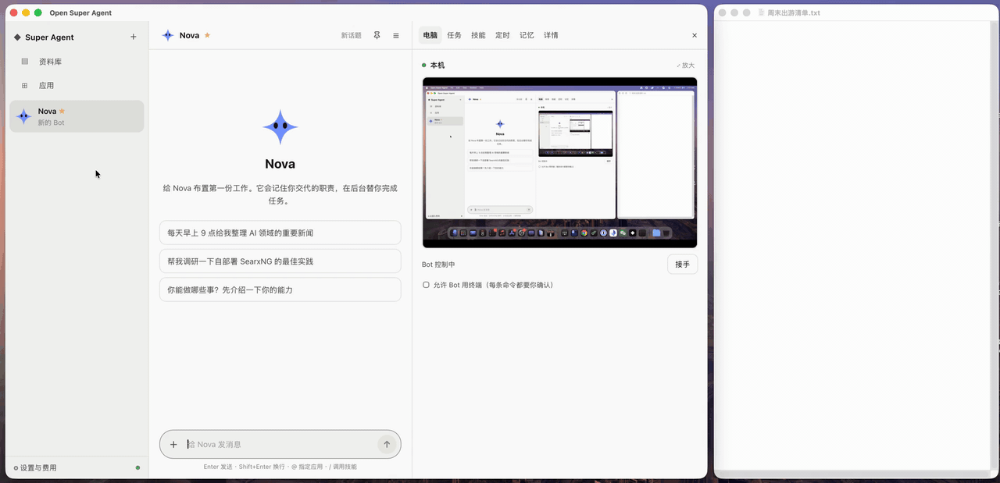

<div align="center">

# open-super-agent

**可以自己部署的常驻 AI 队友：会聊天，会派活，还有一台能看、能接手的电脑。**

开源，可替代 [Grok Bot](https://x.ai/bot)。模型自选，按 token 计费。

[](https://github.com/kadaliao/open-super-agent/actions/workflows/ci.yml)
[](LICENSE)


简体中文 · [English](README.en.md)

<a href="docs/images/demo.mp4"></a>

<sub>群聊交接 → 演示一遍生成技能 → 资料库（等待模型的部分已加速）· <a href="docs/images/demo.mp4">看高清版 MP4</a></sub>

</div>

## 为什么做这个

Grok Bot 的体验很好，但价格高，模型也换不了。open-super-agent 的交互方式参照 Grok Bot：常驻的 Bot、后台任务、一台能实时观看的电脑。架构借鉴 DeepSeek 的 Super-agent 设计（Router / Worker / Watchdog）。部署在你自己的机器上，模型和花费由你决定。

## 功能

- 🤖 **多个 Bot**：每个 Bot 有名字、头像、人设和独立对话；回复流式输出，思考过程可以折叠。可以针对某条消息回复，在旁边的讨论串里单独聊，主对话不被打断。
- 👥 **群聊**：2–6 个 Bot 一个群。`@` 谁谁回答，`@所有人` 大家都说；不 @ 的消息由协调者接，它会分给合适的 Bot。Bot 之间能交接工作，比如一个查完资料，自动交给另一个写总结。要你确认的操作只出现在各自的私聊里。
- ✉️ **Bot 之间私信**：不用拉群，Bot 也能私信另一个 Bot 请它帮忙（“让 postman 看看有没有 Anthropic 的邮件”）。对方在自己的私聊里处理，做完结果自动回到原来的对话，再由它告诉你。
- ⚡ **后台任务**：耗时的活交给 Worker 在后台做，你可以接着聊。**Heavy 模式**下多个 Worker 各自做一遍，再互审汇总。
- 🖥️ **电脑**：所有 Bot 共用一台 Linux 桌面（Chromium 和终端）。几个任务可以同时用，每个任务一个浏览器窗口，登录状态和文件共用，不用排队。网页通过 CDP 直接控制，按元素操作、读页面文字，又快又准；你能实时看屏幕，随时接手和交还；遇到验证码、登录这类步骤，Bot 会请你来做。在自己的电脑上跑时，也可以直接用你装的 Chrome（单独的配置目录，和你日常用的分开），不用 Docker。
- 🔌 **应用市场**：侧栏“应用”里挑应用连接。Notion、flomo、腾讯文档、钉钉、滴答清单、Todoist 等点一下、用账号登录就行；Gmail、QQ 邮箱、飞书、企业微信、GitHub 填一个密码、token 或链接；Slack 建个应用后登录；也能接任意 MCP server。聊天里用 `@` 指定。每个应用是一份清单文件，[写一份提个 PR](docs/apps.md) 就能上架。
- ✅ **确认与保险库**：写操作先弹卡片问你（允许一次 / 拒绝 / 总是允许），规则可在设置里管理；密钥加密保存，不进聊天记录。
- 🧩 **技能**：输入 `/名字` 调用可复用的做事方法；可以让 Bot 把刚才的做法存成技能，也能在右栏编辑。点**演示一遍**，在电脑上亲手做一次，Bot 把录下的操作整理成技能草稿给你审核。技能可以导出成文件、生成分享链接，别人粘贴链接就能装；Claude 等用的 `SKILL.md` 也能直接导入。
- 🎁 **Bot 模板**：新建 Bot 时挑一个现成的（资讯助手、邮件管家、项目观察员、出行助手），技能和定时任务都配好了。自己调好的 Bot 也能做成模板分享出去，[写一个模板](docs/templates.md)提 PR 就能放进内置。
- 🧠 **记忆**：每个 Bot 记得你的偏好和它做过的事；名字、时区这类关于你的基本事实所有 Bot 共享。说“记住……”就行，也能在右栏查看、修改、删除，或从 ChatGPT 等助手导入。聊久了可以点“新话题”，之前的对话不再带进上下文，记忆还在。记忆和资料库能按意思找：Bot 会自己去查以前记下的事和做过的页面。
- 📚 **资料库**：Bot 做好的报告和网页存成页面，可以置顶、生成分享链接；共用电脑里的文件可以浏览、上传、下载。聊天时也能直接发附件。
- ⏰ **定时任务**：每个 Bot 自己的定时任务（每天 / 每周几定时、每隔一段时间、webhook），支持暂停、恢复、测试，保留最近 20 次运行记录。在对话里说“每天 9 点帮我……”就能建。webhook 事件先过关键词过滤，再交给便宜的模型判断要不要处理。
- 💬 **聊天软件**：在 Telegram、飞书、钉钉、企业微信、Discord 里直接和 Bot 说话，和网页上是同一个对话；要你确认的操作变成消息里的按钮，发文件、发语音（钉钉、企业微信）也行。服务器不需要公网地址，[几步就能连上](docs/channels.md)。
- 💻 **桌面 App（macOS 预览）**：安装包约 42 MB，自带运行环境，不用装 Docker 和 Python；Bot 直接用你电脑上的 Chrome。关掉窗口后在菜单栏接着跑，要你确认的操作、做完的任务发系统通知；也能当客户端连到你的服务器。
- 📱 **手机**：能添加到主屏幕当应用用；有语音输入；不开着页面时，需要你确认的事、做完的任务会推送到手机。手机上也能看屏幕、接手电脑打字、处理确认。
- 💰 **费用透明**：按角色、任务和天统计 token 和金额，有每日预算；Watchdog 会自动取消卡住、死循环或超预算的任务。
- 📦 **备份与迁移**：全部数据（连同密钥）导出成一个加密文件，换机器、从本机搬到服务器时上传就能接着用；服务器上也能用命令行定时备份。
- 🔄 **模型自选**：在设置里添加模型服务（DeepSeek、OpenAI、OpenRouter、硅基流动、阿里云百炼、智谱、Kimi、Ollama，或任何兼容 OpenAI 的接口），填 API Key、点一下测试就能用；对话、后台任务等各自选模型，单价自动获取。
- 🌐 **中文 / English**：界面、通知和聊天软件里的消息都有中英文两种，设置里一键切换；英文界面下 Bot 默认用英文回复。

## 适合谁

- **装上就能用**：macOS 桌面 App 只有 42 MB 左右，自带运行环境，不用装 Docker、Python，也不用先装哪个 AI 命令行工具；Bot 直接用你电脑上的 Chrome。想一直开着，就一条 `docker compose up` 放到 VPS 或家里的机器上，在网页、手机、聊天软件里随时用，桌面 App 也能连过去。
- **模型随便换，花多少看得到**：DeepSeek、Kimi、智谱、阿里云百炼、硅基流动、OpenRouter、本机的 Ollama，任何兼容 OpenAI 的接口在设置里填 Key、点一下测试就能用；对话和后台任务可以用不同的模型。按角色、任务、天统计 token 和金额，有每日预算，超了 Watchdog 自动停。
- **在国内用**：在飞书、钉钉、企业微信里直接和 Bot 说话（Telegram、Discord 也行），要你确认的操作变成消息里的按钮；腾讯文档、flomo、滴答清单、QQ 邮箱这些应用登录或填 token 就能接，不经过第三方中转。中英文界面，默认配置不需要任何国外的付费服务。
- **一台电脑大家一起用，任务不排队**：所有 Bot 共用一台电脑，在上面登录一次网站，大家都能用；几个任务同时做，各自一个浏览器窗口。网页按元素直接控制，读页面文字、点编号，比看截图估坐标更快、更准、更省 token。电脑可以是你自己的 Chrome（单独的配置目录）、本地 Docker 里的 Linux 桌面，或者 Instabox 云电脑，前两种不花钱。
- **默认先问再做**：写操作先弹卡片（允许一次 / 拒绝 / 总是允许），规则在设置里管。用你自己的 Chrome 时，上传文件、写文件、点“发送 / 发布 / 付款”也先问，文件只能放在工作文件夹里。密钥加密存在保险库里，不进聊天记录。
- **像一个团队一样干活**：群聊里 Bot 之间交接工作，也能私信别的 Bot 帮忙；Heavy 模式几个 Worker 各做一遍再互审汇总；“演示一遍”把你的操作整理成技能；做好的报告存进资料库、生成分享链接；全部数据能打包成一个加密文件搬到别的机器。

### 和 OpenMausBot 比

[OpenMausBot](https://github.com/milind-soni/OpenMausBot) 也是开源的 Grok Bot 替代品，两边的取舍不一样：

| | open-super-agent | OpenMausBot |
|---|---|---|
| 模型 | 任何兼容 OpenAI 的接口（DeepSeek、Kimi、智谱、Ollama……），按 token 付费，每天花多少看得到 | 主要跑在本机的 `claude`、`codex`、`grok` 命令行上，用你已有的订阅；其他接口改配置接入 |
| 电脑 | 所有 Bot 共用一台，几个任务各开一个窗口同时做；用你的 Chrome、本地 Docker（都免费）或 Instabox 云电脑；操作浏览器和终端 | 每个 Bot 一台：Boat 云电脑（试用后付费）、本地虚拟机，或者你的电脑（能控制整个桌面，支持 macOS 和 Ubuntu Xorg） |
| 应用 | 每个应用一份清单文件，登录或填 token 直接连，包括飞书、钉钉、企业微信、腾讯文档等国内应用；也能接任意 MCP | 经 Composio 接 500 多个应用（第三方服务，要它的账号）；也能接 MCP |
| 在哪用 | 网页、手机（添加到主屏幕、推送）、macOS 桌面 App，以及 Telegram、飞书、钉钉、企业微信、Discord | 桌面 App、网页、iOS / Android App |
| 部署 | `docker compose up` 放到服务器上；macOS 桌面 App（预览） | 桌面 App（macOS、Windows、Ubuntu）；`npx openmausbot serve` 或 Docker 放到服务器上 |
| 安装包 | 42–48 MB（自带 Python 运行环境） | 250–316 MB |
| 密钥 | 加密存在保险库里 | 明文存在 `config.json` 里（文件权限 0600） |

想要 Windows / Linux 桌面 App、原生手机 App、语音对话，想用现成的 Claude、ChatGPT 订阅而不是按 token 付费，或者想让 Bot 控制你的整个桌面，选 OpenMausBot 更合适。（对比依据两边 2026-11-07 的 README 和发布页。）

## 快速开始

在 Mac 上最快的办法是装**桌面 App**（预览版）：到 [发布页](https://github.com/kadaliao/open-super-agent/releases) 下载对应芯片的 dmg，打开后选“在这台电脑上运行”，说明见 [桌面 App](docs/desktop.md)。

放到服务器上一直开着，用 Docker Compose，只需要装 Docker：

```bash
git clone https://github.com/kadaliao/open-super-agent.git && cd open-super-agent
cp .env.example .env     # 可以先填上 DEEPSEEK_API_KEY，也可以打开后在 设置 → 模型 里填
docker compose up -d     # 第一次要构建镜像，大约 5–10 分钟；打开 http://127.0.0.1:8765
```

第一次打开会有引导：接上一个模型服务、认识你的 Bot（或从模板装一个）、连一个常用应用，三步就能开始用。

自动 HTTPS、电脑改用 Instabox、国内镜像源、备份，见 [用 Docker Compose 部署](docs/docker.md)。

<details>
<summary>不用 Docker 运行</summary>

需要 Python ≥ 3.11 和 [uv](https://docs.astral.sh/uv/)、Node ≥ 20；本地 Docker 电脑仍要 Docker（用 Instabox 或本机 Chrome 时不需要，见 [配置 → 电脑](docs/configuration.md#电脑)）。

```bash
export DEEPSEEK_API_KEY=sk-...              # 可选，也可以打开后在 设置 → 模型 里填；环境变量一览见 .env.example
(cd web && npm ci && npm run build)         # 构建前端
uv run uvicorn osa.server:app --port 8765   # 打开 http://127.0.0.1:8765
```

第一次用电脑时会自动构建本地镜像，需要几分钟。国内网络可以先手动构建，用镜像源加速：

```bash
docker build --build-arg APT_MIRROR=mirrors.ustc.edu.cn -t osa-computer:1 osa/computer/image
```

</details>

> [!WARNING]
> 默认**不用登录**，只能在本机或内网（例如 Tailscale）使用。要部署到公网，先设置 `OSA_PASSWORD` 打开登录，再用 HTTPS 访问，见 [配置 → 部署到公网服务器](docs/configuration.md#部署到公网服务器) 和 [SECURITY.md](SECURITY.md)。

## 文档

| 文档 | 内容 |
|---|---|
| [用 Docker Compose 部署](docs/docker.md) | 一条命令跑起来、自动 HTTPS、数据和备份、国内网络 |
| [配置](docs/configuration.md) | 模型服务和各项工作用的模型、限额与单价、电脑后端、应用、确认规则与保险库、定时任务、远程访问 |
| [架构](docs/architecture.md) | 各组件如何协作、代码目录、设计约定 |
| [开发](docs/development.md) | 本地开发、测试方法、调试技巧 |
| [桌面 App（预览）](docs/desktop.md) | macOS 桌面 App：在这台电脑上运行或连接服务器、系统通知、菜单栏、自动更新 |
| [聊天软件](docs/channels.md) | 连接 Telegram、飞书、钉钉、企业微信、Discord，配对，权限和常见问题 |
| [给应用市场加应用](docs/apps.md) | 应用清单的格式、图标、在本机试、提 PR |
| [写一个 Bot 模板](docs/templates.md) | 模板的格式、从现有 Bot 导出、加进内置 |
| [路线图](docs/roadmap.md) | 接下来的方向和先后顺序；之前对齐 Grok Bot 的计划见 [这里](docs/grok-bot-parity.md) |
| [更新日志](CHANGELOG.md) | 各版本的变化 |

## 路线图

和 Grok Bot 对齐的功能已经全部做完（v0.3.0，见 [更新日志](CHANGELOG.md)）。接下来的方向：

- **应用生态**：应用和 Bot 模板主要靠社区提 PR 收录，项目补齐清单格式和连接方式上缺的能力。
- **更多客户端**：macOS 桌面 App 正式版，然后是 Windows 版；iOS / Android 原生 App；在聊天软件的群里使用机器人。
- **电脑**：让 Bot 控制整个桌面（不只是浏览器），“演示一遍”跟着扩展；服务器上的 Bot 借用你电脑上的浏览器；快照与回滚。
- **Bot 能力**：语音对话。

每个方向的考虑和先后顺序见 [docs/roadmap.md](docs/roadmap.md)。想要的功能欢迎提 issue。

## 参与贡献

欢迎提 issue 和 PR，开始前请先读 [CONTRIBUTING.md](CONTRIBUTING.md)。

## 致谢

- DeepSeek Super-agent（2026-10 技术博客）：Router / Worker / Watchdog / Inline & Spill 的架构思路
- [Grok Bot](https://x.ai/bot)：产品形态和交互方式
- [Instabox](https://instabox.sh)、[noVNC](https://github.com/novnc/noVNC)、[Model Context Protocol](https://modelcontextprotocol.io)

## 许可证

[MIT](LICENSE) © Kada Liao
