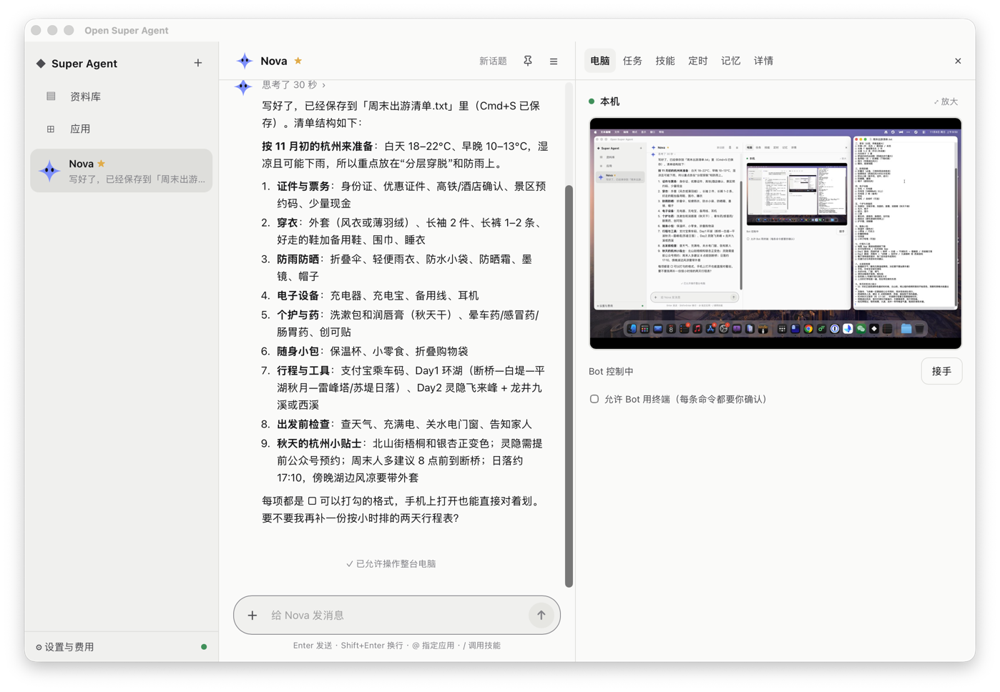

# 桌面 App

macOS 的桌面 App，Apple 芯片和 Intel 都有。Windows 版以后再做。

到 [发布页](https://github.com/kadaliao/open-super-agent/releases) 下载对应芯片的 dmg，或者用 Homebrew：

```bash
brew install --cask kadaliao/tap/open-super-agent
```

App 自己会检查更新，所以 `brew upgrade` 默认跳过它。`brew uninstall --cask --zap open-super-agent` 会连数据一起删。

<p align="center"></p>

## 两种用法

第一次打开时选，之后在菜单栏图标 → 切换服务器 里换：

- **在这台电脑上运行**：App 自带运行环境，不用装 Docker、Python。数据在 `~/Library/Application Support/open-super-agent`：
  - `data/`：服务的数据目录（数据库、密钥、工作目录），和服务器部署时的 `data/` 一样，可以用 设置 → 备份与迁移 搬到服务器上；
  - `logs/server.log`：服务的日志；
  - `desktop.json`：选的用法、服务器地址、端口。

  服务只监听本机的 `127.0.0.1:18765`（被占用时换一个并记住），开了登录：密码是第一次打开时随机生成的，存在钥匙串里（“Open Super Agent (desktop)”），
  App 自己登录，不用你输。菜单栏里的“在浏览器里打开”会让浏览器也登录上。
  Bot 的电脑默认用这台电脑上装的 Chrome（开一个单独的配置目录，和你日常用的分开），不用 Docker，
  说明见 [配置 → 本机 Chrome](configuration.md#电脑)。没装 Chrome 的话先装一个；也可以在电脑面板上方换成本地 Docker 或 Instabox。

  想让 Bot 不只用浏览器、还能用这台 Mac 上的其他 App，在电脑面板勾上“允许 Bot 操作整台电脑”，再点“去打开权限”，
  在系统设置里给 Open Super Agent 打开“辅助功能”和“屏幕录制”（打开后还显示没有，就退出 App 再打开）。
  之后 Bot 能看整个屏幕、用你的鼠标键盘操作微信、访达、备忘录这些 App；每个任务第一次用先问你，Bot 操作时你动一下鼠标或键盘它就停下。
  细节见 [配置 → 本机 Chrome](configuration.md#电脑)。连着服务器时，用下面的“借给服务器”。
- **连接到我的服务器**：填地址（比如 `https://osa.example.com`），在 App 里登录。App 只是一个客户端，服务和数据都在服务器上。
  Bot 默认用服务器那边的电脑（电脑面板写着“服务器上的 Chrome / Docker”或 Instabox）。

  **把这台 Mac 借给服务器**：电脑面板下面点“借给服务器”，Mac 上会弹窗问你，同意后服务器上的 Bot 就能用这台 Mac（电脑类型“你的 Mac”）：
  - App 在后台起一个小程序（`osa/computer/agent.py`），它主动连到服务器（`wss://服务器/api/computer/link`），服务器不用连进你家里的网络。
    凭据是服务器发的随机令牌，存在钥匙串里（“Open Super Agent (desktop)”，按服务器地址分开）；日志在 `logs/agent.log`。
  - Bot 用这台 Mac 上单独开的 Chrome，和“在这台电脑上运行”时是同一个配置目录（登录过的网站两边都能用）；文件只放在工作文件夹里；**不能执行终端命令**。
  - 操作整个屏幕要两边都打开：服务器上勾“允许 Bot 操作整台电脑”，**再在这台 Mac 上允许**（面板里的“允许”按钮或菜单栏图标 →
    允许服务器操作屏幕，都会弹窗问你）。Mac 上的这个开关服务器改不了。其余规则和本机一样：每个任务第一次用先问你、你一动鼠标就停、锁屏时不动。
  - 一次只借一台。断开：电脑面板里的“断开”，或者菜单栏图标 → 断开服务器借用这台 Mac；退出 App、Mac 睡着时 Bot 用不了它，
    任务会说“你的 Mac 没连上”。在服务器那边作废了的话，App 隔几分钟才再试。
  - 在别的设备上（手机、浏览器）也能看到并选“你的 Mac”，只是“借给服务器”和 Mac 上的开关只能在这台 Mac 的 App 里点。

## 和网页比多了什么

- 关掉窗口只是藏到菜单栏，服务和定时任务接着跑；退出要用菜单栏图标 → 退出，或者 ⌘Q。
- Bot 的回复、任务结果、等你确认的操作发系统通知（正看着那个对话时不发），点通知打开对应的对话；菜单栏图标旁边显示有几个操作等你确认。
- ⌘⇧空格 呼出或藏起窗口。
- 菜单栏图标 → 开机时启动：开机后在菜单栏里待着，不弹窗口。
- 把文件拖进窗口就能发给 Bot（网页版也能）。
- 别的网站的链接用系统浏览器打开；应用的登录授权在 App 里的小窗完成。
- 自动更新：启动半分钟后和之后每 6 小时看一次有没有新版，有就在后台装好，下次打开时生效。菜单栏图标 → 检查更新 可以手动看。

暂时没有：语音输入（App 里的 WebKit 不支持网页的语音识别）。

## 从源码运行

需要 [Rust](https://rustup.rs)、Node ≥ 20、uv。

```bash
(cd web && npm ci && npm run build)          # 服务端要用构建好的前端
cd desktop && npm ci
npx tauri dev                                # 开发版：用仓库里的 .venv 起服务
```

开发版的数据也在 `~/Library/Application Support/open-super-agent`。测试时用 `OSA_DESKTOP_HOME=/某个临时目录` 换个地方，不碰真正的数据；
这时本机服务的密码存在那个目录里，不进钥匙串。

打一个能单独用的 App：

```bash
desktop/scripts/build-runtime.sh             # 准备 Python 运行环境（desktop/build/），可以加 aarch64 或 x86_64
cd desktop && npx tauri build --bundles app  # 带自动更新包时要设 TAURI_SIGNING_PRIVATE_KEY，见下面
```

运行环境：独立版 Python 3.13（python-build-standalone）+ 按 `uv.lock` 装的依赖 + uv（uvx 应用要用），去掉了 pip、调试符号这些，约 106 MB；
`.pyc` 写到数据目录旁边。Intel 版的 cryptography 用 48.0：从 49.0 起它不再提供 Intel Mac 的安装包。

## 发布

打 `v*` 的 tag 时，`.github/workflows/desktop.yml` 打两个 dmg 和自动更新包，传到这个版本的 release，
再更新 `desktop-updates` 这个 release 里的 `latest.json`（装好的 App 从这里看有没有新版，不要删）。tag 里带 `-` 的（比如 `v0.7.0-preview.1`）发成 pre-release。
`desktop/package.json` 的版本号要和 tag 一致，不然打包会失败。
正式版（不带 `-`）发出后，再改 [kadaliao/homebrew-tap](https://github.com/kadaliao/homebrew-tap) 里的 `Casks/open-super-agent.rb`：`version` 和两个 `sha256`（`gh release view vx.y.z --json assets` 能看到每个 dmg 的 sha256）。

仓库的 Secrets：

| 名字 | 用途 |
|---|---|
| `TAURI_SIGNING_PRIVATE_KEY`、`TAURI_SIGNING_PRIVATE_KEY_PASSWORD` | 给自动更新包签名。公钥在 `desktop/src-tauri/tauri.conf.json`，换了密钥，已经装好的 App 就收不到更新了 |
| `APPLE_CERTIFICATE`、`APPLE_CERTIFICATE_PASSWORD` | “Developer ID Application” 证书导出的 `.p12`（base64）和它的密码 |
| `APPLE_API_KEY_P8`、`APPLE_API_KEY_ID`、`APPLE_API_ISSUER` | App Store Connect 的 API key（`.p8` 文件的内容）、Key ID 和 Issuer ID，公证用 |

配了 Apple 的那几项时：App 里带的 Python 运行环境先逐个签名（`desktop/scripts/sign-runtime.sh`），Tauri 签名并公证 App，CI 再公证 dmg 并把结果钉上，下载后双击就能打开。没配的话安装包只有临时签名：下载后第一次打开会被拦下，要去 系统设置 → 隐私与安全性 点“仍要打开”。
