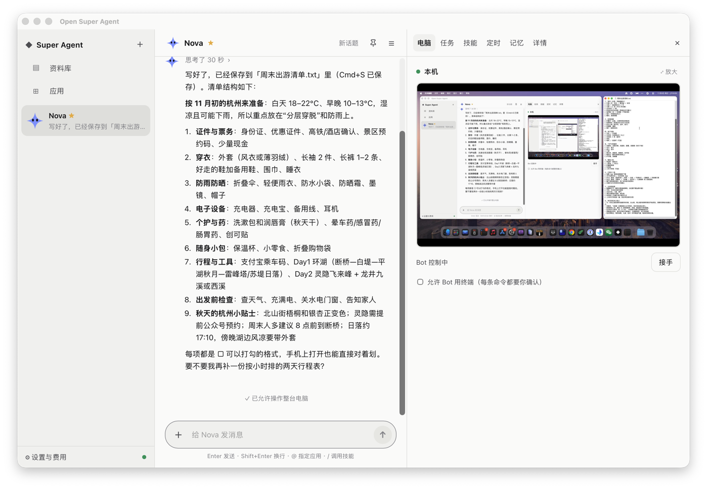

# 桌面 App

macOS 的桌面 App，Apple 芯片和 Intel 都有。Windows 版以后再做。

到 [发布页](https://github.com/kadaliao/open-super-agent/releases) 下载对应芯片的 dmg，或者用 Homebrew：

```bash
brew install --cask kadaliao/tap/open-super-agent
```

App 自己会检查更新，所以 `brew upgrade` 默认跳过它。`brew uninstall --cask --zap open-super-agent` 会连数据一起删。

<p align="center"></p>

## 两种用法

第一次打开时选，之后在菜单栏图标 → 切换服务器 里换（设置左下角也有“切换服务器”）：

- **在这台电脑上运行**：App 自带运行环境，不用装 Docker、Python。数据在 `~/Library/Application Support/open-super-agent`：
  - `data/`：服务的数据目录（数据库、密钥、工作目录），和服务器部署时的 `data/` 一样，可以用 设置 → 备份与迁移 搬到服务器上；
  - `logs/server.log`：服务的日志；
  - `desktop.json`：选的用法、服务器地址、端口。

  服务只监听本机的 `127.0.0.1:18765`（被占用时换一个并记住），开了登录：密码是第一次打开时随机生成的，存在钥匙串里（“Open Super Agent (desktop)”），
  App 自己登录，不用你输，所以设置里没有“退出登录”。菜单栏里的“在浏览器里打开”会让浏览器也登录上。
  Bot 用哪台电脑在 设置 → 电脑 里选（电脑面板上点“换电脑”也会去那里），选好一直用，默认是 **本机**：
  - **本机**：就是这台 Mac，不用 Docker，电脑面板上的画面跟着 Bot 走。它有自己的浏览器窗口（用你装的 Chrome，配置和你日常用的分开），
    没装 Chrome 的话先装一个。给 Open Super Agent 打开“辅助功能”和“屏幕录制”权限后，Bot 还能看整个屏幕、用你的鼠标键盘操作微信、访达、
    备忘录这些 App（电脑面板上列着还缺哪项，有“去打开”按钮）；每个任务第一次用屏幕先问你，Bot 操作时你动一下鼠标或键盘它就停下。
    终端默认关，在电脑面板勾上“允许 Bot 用终端”后才能执行命令，每条都先问你。
  - **Docker 沙盒**：Bot 在本地 Docker 容器里的 Linux 桌面上做事，碰不到你的文件和别的 App。要先装好并打开 Docker Desktop（或 OrbStack）；
    第一次用要准备电脑镜像，几分钟。容器能连到这台 Mac 上只对本机开放的服务，见 [SECURITY.md](../SECURITY.md)。
  - **云电脑**：Instabox 的云主机，Mac 关机、睡着也照常跑。第一次选会让你填 Instabox 的 API Key（加密存在保险库里）。
  细节见 [配置 → 电脑](configuration.md#电脑)。
- **连接到我的服务器**：填地址（比如 `https://osa.example.com`），在 App 里登录。App 只是一个客户端，服务和数据都在服务器上。
  Bot 平时用服务器那边的电脑（**Docker 沙盒** 或 **云电脑**），不用服务器自己。

  **把任务派到你的 Mac**：有的事只有你的 Mac 上才做得了（那台 Mac 上登录着的 App 或网站、本地文件、只装在 Mac 上的软件）。
  在电脑面板下面的“你的 Mac”里点 **允许 Bot 把任务派到这台 Mac**，Mac 上会弹窗问你；同意后，服务器上的 Bot 派任务时可以指定在这台 Mac 上做，
  每次派过来都先在对话里弹卡片问你（可以“总是允许”）。那个任务用的就是这台 Mac（浏览器、工作文件夹，有权限的话还有屏幕和鼠标键盘），
  别的任务照常用服务器那边的电脑。
  - 你在几台电脑上都开着 App 的话，每台都能加进来，Bot 按名字（那台 Mac 的电脑名）挑。“你的 Mac”里列着每台连没连着、有几个任务在用（能看画面）、
    缺哪个权限；在任何设备上都能把某台移除，也可以在那台 Mac 的菜单栏图标 → 不再让服务器派任务到这台 Mac。
  - 终端每台单独开，默认关。勾上“允许 Bot 用终端”（手机上、浏览器里也能勾，人不在 Mac 前也行），派到这台的任务就能执行命令：
    工作目录是工作文件夹，用你的账号运行，环境变量里的密钥不传过去；每条命令执行前都在对话里问你（“总是允许”过的命令开头除外）。
    要这台 Mac 上的 App 是新版，旧版的勾选框是灰的。
  - App 在后台起一个小程序（`osa/computer/agent.py`），它主动连到服务器（`wss://服务器/api/computer/link`），服务器不用连进你家里的网络，
    断线自动重连。凭据是服务器发的随机令牌，存在钥匙串里（“Open Super Agent (desktop)”，按服务器地址分开）；日志在 `logs/agent.log`。
  - Bot 的浏览器和“在这台电脑上运行”时是同一个配置目录，登录过的网站两边都能用。
  - 退出 App、Mac 睡着时派不过去，Bot 会告诉你那台 Mac 没连上。在服务器那边移除了的话，App 隔几分钟才再试。

## 和网页比多了什么

- 关掉窗口只是藏到菜单栏，服务和定时任务接着跑；退出要用菜单栏图标 → 退出，或者 ⌘Q。
  退出时有任务正在做一步（比如在跑一条命令、在操作网页），先等它做完、存好，最多 35 秒；下次打开时这些任务接着做。没有任务在做时马上退出。
- Bot 的回复、任务结果、等你确认的操作发系统通知（正看着那个对话时不发），点通知打开对应的对话；菜单栏图标旁边显示有几个操作等你确认。
- ⌘⇧空格 呼出或藏起窗口。
- 菜单栏图标 → 开机时启动：开机后在菜单栏里待着，不弹窗口。
- 把文件拖进窗口就能发给 Bot（网页版也能）。
- Bot 发来的文件点了直接存到“下载”文件夹，存好了发通知；PDF、图片、纯文本这类照样开新窗口看。
- 别的网站的链接用系统浏览器打开；应用的登录授权在 App 里的小窗完成。
- 自动更新：启动半分钟后和之后每 6 小时看一次有没有新版，有就在后台装好，窗口顶上出现“重启更新”，菜单栏里的“检查更新…”也变成“重启更新到 x.y.z”，
  点一下就重启换上（不点的话下次打开时生效）。菜单栏图标 → 检查更新 可以手动看。连着服务器时，服务器升级了界面，窗口顶上会提示“更新”，点了刷新。

暂时没有：语音输入（App 里的 WebKit 不支持网页的语音识别）。

## 从源码运行

需要 [Rust](https://rustup.rs)、Node ≥ 20、uv。

```bash
(cd web && npm ci && npm run build)          # 服务端要用构建好的前端
desktop/scripts/build-server.sh              # 编译 osa-server，准备 desktop/build/（开发版也要：Tauri 要这几个文件在）
cd desktop && npm ci
npx tauri dev                                # 开发版：起 desktop/build 里的 osa-server
```

开发版的数据也在 `~/Library/Application Support/open-super-agent`。测试时用 `OSA_DESKTOP_HOME=/某个临时目录` 换个地方，不碰真正的数据。
开发版和设了 `OSA_DESKTOP_HOME` 时，本机服务的密码存在数据目录的 `local-server.secret` 里，不进钥匙串。

打一个能单独用的 App：

```bash
desktop/scripts/build-server.sh              # 编译 osa-server、准备 desktop/build/，可以加 aarch64 或 x86_64
cd desktop && npx tauri build --bundles app  # 带自动更新包时要设 TAURI_SIGNING_PRIVATE_KEY，见下面
```

App 里带的服务是 Rust 版的 osa-server（一个约 24 MB 的文件，Tauri 当 externalBin 放进 `Contents/MacOS` 并签名），
另有 `Resources/app`（config.yaml、前端、本机电脑的镜像文件）。整个 App 约 46 MB。App 不带 Python：
uv 第一次用到时（装 uvx 应用、run_code 要 Python、操作整台 Mac）才下载到 `~/Library/Application Support/open-super-agent/runtime/bin`
（固定版本，按 sha256 校验，见 `server/crates/osa/src/runtime.rs`），Python 再由 uv 下载到 `runtime/python`。

第一次打开（`desktop/setup/`，步骤在 `src-tauri/src/onboard.rs`）：欢迎页选用法 → “正在准备”一步一步显示：检查网络、启动服务、
下载 uv、安装 Python（`osa-server setup` 一行一行报进度）→ “准备好了”。下载失败可以重试、换下载源，或者先用着（用到时再下载）。
检查网络的办法照 Linger：同时从官方源和阿里云镜像下载 uv 安装包的前 512 KB，镜像快 1.5 倍以上就算国内网络，记在 `desktop.json` 的
`mirror`（`cn` / `global`）。菜单栏的“下载源”能换：自动（每次启动后在后台再测一次，下次启动按新结果，不拖慢启动）、
国内镜像、官方源（手动选的记在 `mirror_pref`，换了马上带着新设置重新起本机服务）；第一次的启动页上也能换。服务带着 `OSA_MIRROR=cn` 起来时，uv 的包（阿里云 PyPI）、Python（npmmirror 的
python-build-standalone）、npm（npmmirror）都走国内镜像，已经单独设了的环境变量不动。

## 发布

打 `v*` 的 tag 时，`.github/workflows/desktop.yml` 打两个 dmg 和自动更新包，传到这个版本的 release，
再更新 `desktop-updates` 这个 release 里的 `latest.json`（装好的 App 从这里看有没有新版，不要删）。tag 里带 `-` 的（比如 `v0.7.0-preview.1`）发成 pre-release。
`desktop/package.json` 的版本号要和 tag 一致，不然打包会失败。
正式版（不带 `-`）发出后，[kadaliao/homebrew-tap](https://github.com/kadaliao/homebrew-tap) 的 `bump` 工作流每 6 小时自动把 `Casks/open-super-agent.rb` 追到最新版；
想马上更新就跑 `gh workflow run bump.yml -R kadaliao/homebrew-tap`。

仓库的 Secrets：

| 名字 | 用途 |
|---|---|
| `TAURI_SIGNING_PRIVATE_KEY`、`TAURI_SIGNING_PRIVATE_KEY_PASSWORD` | 给自动更新包签名。公钥在 `desktop/src-tauri/tauri.conf.json`，换了密钥，已经装好的 App 就收不到更新了 |
| `APPLE_CERTIFICATE`、`APPLE_CERTIFICATE_PASSWORD` | “Developer ID Application” 证书导出的 `.p12`（base64）和它的密码 |
| `APPLE_API_KEY_P8`、`APPLE_API_KEY_ID`、`APPLE_API_ISSUER` | App Store Connect 的 API key（`.p8` 文件的内容）、Key ID 和 Issuer ID，公证用 |

配了 Apple 的那几项时：Tauri 签名（连同 osa-server）并公证 App，CI 再公证 dmg 并把结果钉上，下载后双击就能打开。没配的话安装包只有临时签名：下载后第一次打开会被拦下，要去 系统设置 → 隐私与安全性 点“仍要打开”。
