# Features

[简体中文](features.md) · English

The README lists the highlights; this is the full list. For setup see [Configuration](configuration.md), and for how it works see [Architecture](architecture.md) (both in Chinese).

## Bots and conversations

- **Multiple Bots**: each has its own name, avatar, persona and conversation. Replies stream in, and the model's reasoning can be expanded or collapsed.
  Upload an avatar, or have AI draw one from the Bot's name and role.
- **Threads**: reply to any message in a side thread to dig into it without derailing the main chat. When a bot replies in a thread,
  a reminder floats at the bottom of the chat and opens it in one click; the Threads button at the top lists every thread in the chat.
  Unread replies survive reloads and sync across devices, and clear everywhere once you read them.
- **Group chats**: 2–6 Bots in one chat.
  - `@` a Bot to have it answer, or `@everyone`; unaddressed messages go to the group's coordinator, who hands work to the right Bot.
  - Bots hand off to each other: one researches, and the next writes the summary when the research is done.
  - Approval requests stay in each Bot's private chat.
- **Bots message each other**: no group needed. A Bot can DM another Bot for help ("ask Postman whether there's mail from Anthropic").
  The other Bot works in its own chat, and the result comes back to the original conversation automatically.
- **The main Bot manages Bots**: ask it in chat to look up, create, edit or delete any Bot.
  - Look up: "which Bots do I have?", "what skills and routines does Radar have?" It reads each Bot's full profile before answering.
  - Create: "make a Bot that finds resources and saves them to my cloud drive". It writes the name, role, avatar and skills.
  - Edit: "add a rule to Radar's role: AI news only", "rename Researcher to Deep". Name, role, avatar and skills can all change; when editing a role
    it only touches what you asked for, and the card strikes through removed text and highlights added text. The main Bot views, creates, edits, pauses and deletes other Bots' routines directly, without a card.
  - Delete: the card lists what goes with it (chat history, skills, routines, its own memories, which groups it leaves). This can't be undone.
  - Creating, editing and deleting always show a card first and happen only when you approve. Decline with a note and it revises and asks again,
    or click Edit on the card to change the role yourself before approving.
  Other Bots can edit themselves; to create, delete or edit another Bot they ask the main Bot, and you still confirm.
- **Background tasks**: workers run long jobs while you keep chatting. The Tasks tab on the right shows every step and how long it took, live while it runs.
  **Heavy mode** has several workers do the same job, then cross-review and merge.
- **Talk to a task, pick it back up**:
  - Task details have a message box. A running task gets your message before its next step; a finished, failed or canceled task picks the job back up
    with your message and posts another result ("Round 2"). **Follow up** on a result card opens that box. What you said shows up as "You" in the steps,
    and as a "To task #N" message in the chat.
  - Reply in a thread under a task's message and it goes straight to the task without waking the Bot. Keep talking about a task in the chat
    and the Bot passes your words on to that task instead of starting a new one.
  - A task can stop and ask you: the card shows the question and options; pick one, type your own answer, or **Skip**.
    The task list tells "Waiting for your answer", "Needs you to take over" and "Needs your approval" apart.
  - **Try again** on a failed, canceled or interrupted task continues from where it stopped, without redoing finished steps.
    Heavy-mode tasks and tasks from before the update can't be continued.
- **Tasks survive restarts and errors**:
  - After the server restarts, tasks that were running carry on. A normal shutdown first lets the step in progress finish and get saved.
  - Temporary model errors are retried after 15, 30 and 60 seconds; a task that stalls is retried once from its last step.
  - A write that was running during a restart, a stall or a stop (sending mail, submitting a form) may or may not have gone through. The Bot doesn't redo it;
    it checks first with read-only tools. If it can't tell and wants to run it again, you get a card showing which step, when it started and what the Bot checked,
    with **Do it again**, **It went through, don't redo it** and **Don't, stop the task**. This asks even if you chose "Always allow" before.
- **Memory**:
  - Each Bot remembers your preferences and the work it has done; basic facts about you (name, time zone) are shared by all Bots; things that only concern one project are kept under that project (see "Requests board" below).
  - Just say "remember ...", or view, edit, delete and import (for example from ChatGPT) in the side panel. Anything that looks like a password or key isn't stored; you're pointed to the vault instead.
  - Things with a date (an event, a deadline, a quote's validity) get an expiry date and stop being sent to the model after that day. Pin the ones that should stay.
  - **Tidied up every night**: expired notes are removed, duplicates merged, outdated ones rewritten, and the day's work is written up as a daily digest.
    The memory panel has **Tidy up now**, and **Undo** if you don't like the result.
  - Start a **new topic** to drop old messages from the context while keeping memories.
  - Memories and the library are searchable by meaning, and Bots look up past notes and pages on their own.

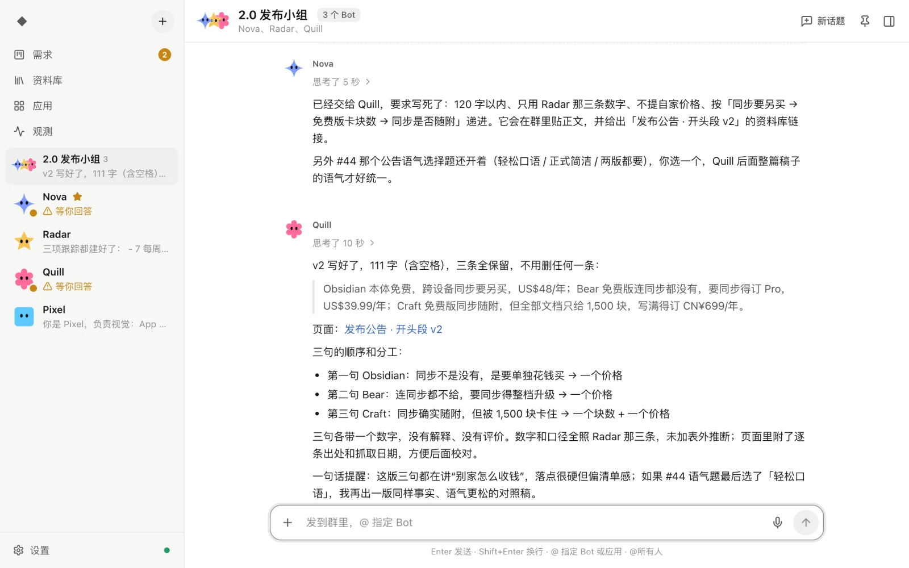

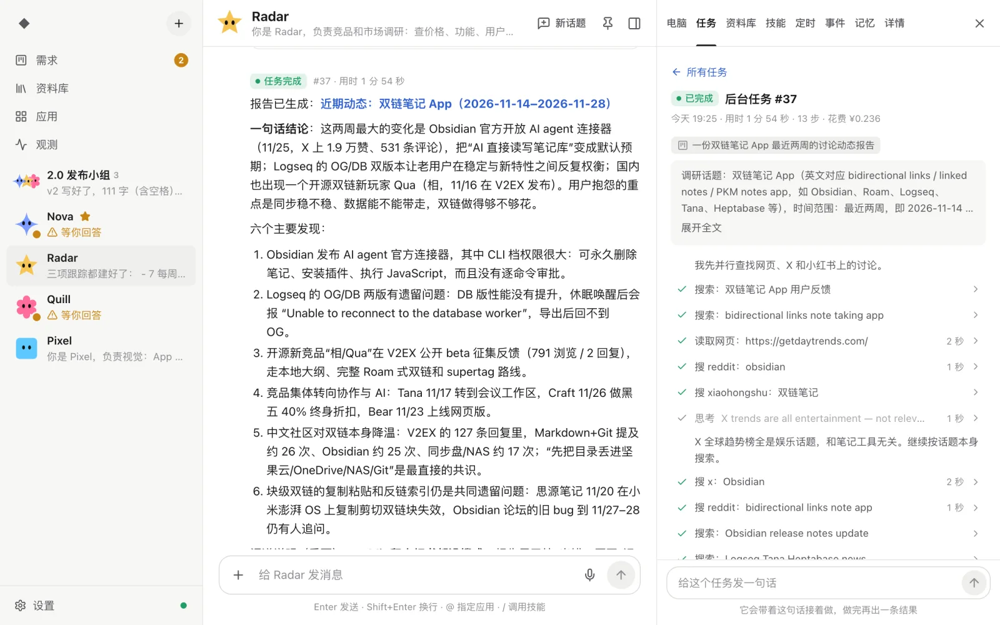

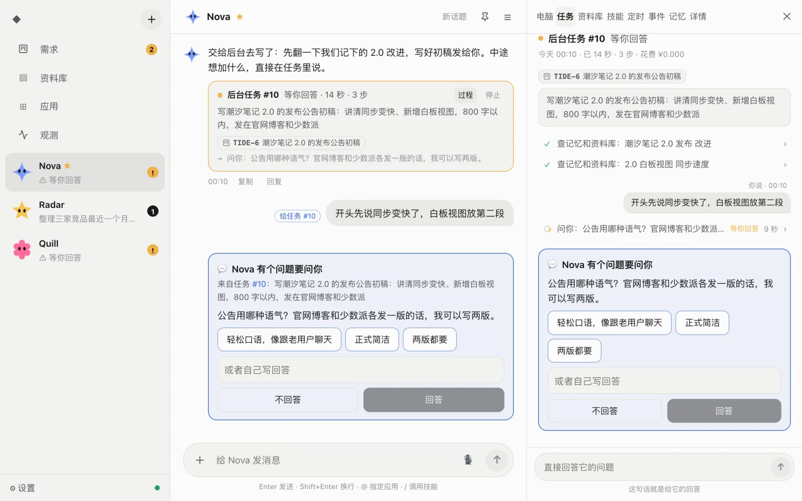

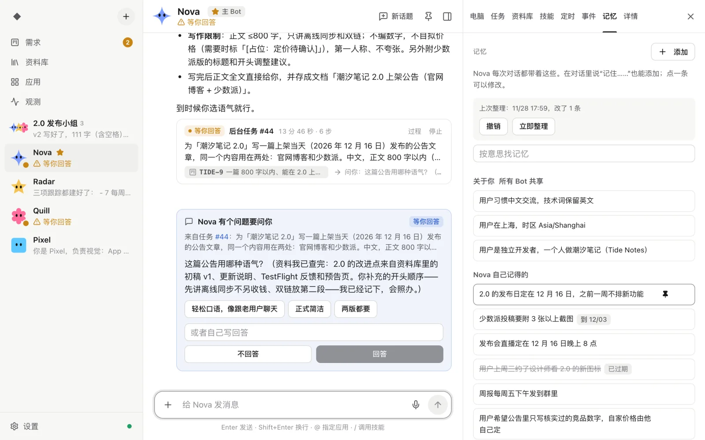

## Requests board

- **Requests** in the sidebar: one card for each thing you asked for, in four columns (To do, In progress, Needs you, Done), with canceled cards folded below.
  The tasks behind a card decide its column: a running task means In progress; a task waiting for your answer or approval, or one that failed or was interrupted, means Needs you.
  The number in the sidebar counts cards that need you.
- **Projects**: cards belong to projects and are numbered by project (`OPC-12`). A project has a name, a brief, a folder and a GitHub repo; the brief and folder are passed to every task working on its cards.
- **Make your own cards**: a title and description, a project, which Bot it goes to, then **Add to To do** or **Start now**. **Start after** picks other cards;
  once they're all done this one starts by itself, with their results attached. If any of them was canceled or failed, it doesn't start.
- **Drag to act**: drag from To do to In progress to start, or onto Done to mark it done (if tasks are still running you're asked first). On a phone you see one column at a time and use the buttons on the card.
- Filter by project and creation date, search numbers, titles and descriptions; archive finished cards and bring them back from the archive.
- **Card page**: description, what you said, questions waiting for you, results, and the tasks behind it. Title, description, project, assignee and "Start after" can all be changed.
- **Wired into the chat**:
  - When a Bot starts a task for something you asked in chat, it makes a card titled with what you'll get; tasks from the same turn share one card.
  - Start a message with a card number ("OPC-12 add the UK too") and, if exactly one task is running on that card, the message goes straight to it.
  - Say "merge these two", "drop OPC-12" or "move it to the website project" and the Bot updates the cards.
  - The task list, task details and task cards in the chat show which card a task belongs to and open it on click; from a card you can open a task and come back.
- **Project memory**: Board → Projects → Memory, for the project's conventions, accounts to use or delivery format. Only tasks of that project read it; in chat, a Bot sees the memory of projects whose cards are in progress.

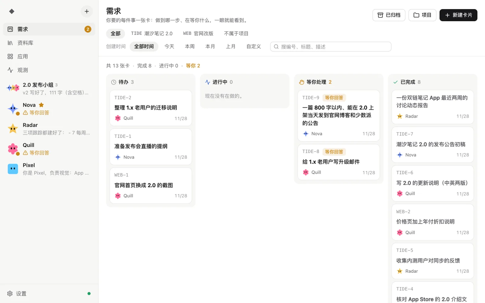

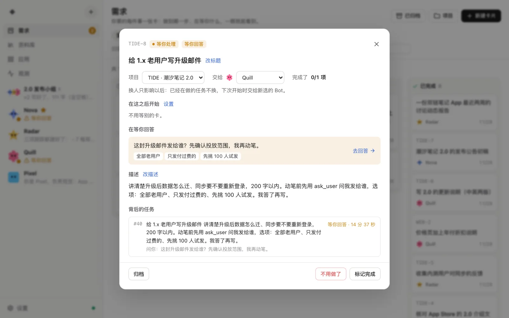

## The computer

- All Bots share one computer. Several tasks can use it at once, each in its own browser window, sharing logins and files instead of queueing.
- Web pages are driven directly over CDP, by element and by reading page text, which is faster, more precise and cheaper in tokens than guessing coordinates from screenshots.
- Watch it live and take over or hand back at any time; for captchas and logins, the Bot asks you to step in.
- The computer is one of these three; the first two are free:
  - this computer: the default in the desktop app, no Docker needed. Bots get their own browser window (a profile apart from your everyday one) and, once you grant the permissions, the whole screen, mouse and keyboard;
  - a Linux desktop (Chromium and a terminal) in local Docker;
  - an [Instabox](https://instabox.sh) cloud machine.

  Choose in Settings → Bot computer and it stays that way: all three in the desktop app; Docker or the cloud machine on a server (a server never uses itself as the computer).
- **Send tasks to your Mac**: when the service runs on a server, some jobs can only be done on your Mac (apps you're signed in to, local files). Once you allow it in the Mac desktop app,
  Bots on the server can send a task to that Mac; you can add several Macs, each with its own terminal switch. See [Desktop app](desktop.md) (Chinese).
- On this computer it is more careful: uploading files, writing files and clicking "send / publish / pay" all ask first, files stay inside the workspace folder, and the terminal is off by default;
  each task asks before it first uses the screen, and the Bot stops as soon as you move the mouse or press a key.

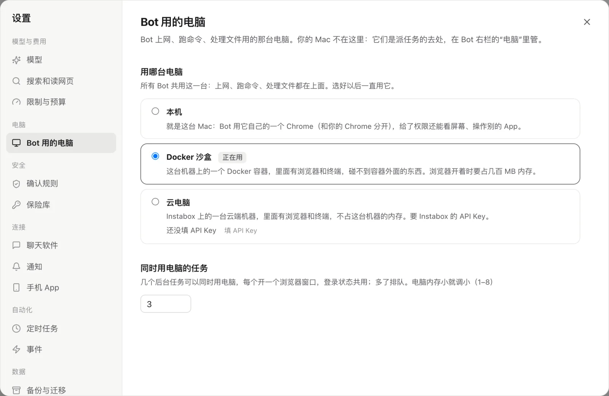

## Web search and reading

- **Works without setup**: free services (Exa, direct fetching and others) are used by default; no API key needed. Settings → Search & web pages opens on an overview:
  one row each for web search, page reading and each platform's posts, showing which service is in use, whether it's free, and how many backups there are. When a paid service is in use (DeepSeek comes first if you have it), it says which rows cost money and whose account pays.
- **Several providers in turn**: under "Choose services" below the overview, turn providers on and order them: DeepSeek (first by default when you have a DeepSeek model provider), Exa (free), Tavily, Brave, Bocha, SearXNG, with DuckDuckGo last;
  page reading also has Jina Reader and direct fetching. If one errors, is rate-limited or finds nothing, the next one is tried. Other providers are recipes added in `config.yaml`, no code changes.
- **Only recent results**: for news and current events, Bots search just the last few days.
- **Blocked sites**: sites on this list (baidu.com by default) are dropped from results, and Bots won't read or open them.
- **Posts on social platforms**: see what people say on X, Reddit and Xiaohongshu, with like, comment and repost counts. Free routes come first (Exa finds posts, and X posts get their counts for free);
  the paid X API is used only when needed, with a per-task budget (US$0.05 by default). Xiaohongshu and Reddit posts are read in the computer's signed-in browser; you log in the first time.
- The `/recent-buzz` skill in the skill market searches all of these and writes a cited report with engagement counts to the library; it can run as a weekly routine. See [Configuration](configuration.md#搜索和读网页) (Chinese).

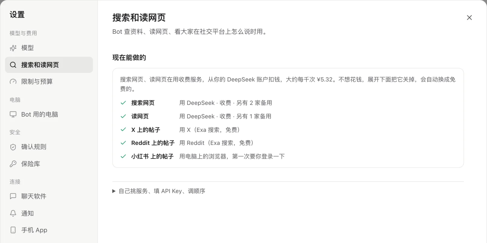

## Apps, skills and templates

- **App market**: pick apps from the sidebar's Apps page; 40 are listed today.
  - Notion, flomo, Tencent Docs, DingTalk, TickTick, Todoist and others: one click and an account login.
  - Gmail, QQ Mail, Feishu, WeCom and GitHub: a single password, token or link.
  - Slack: a small app you create once. Any MCP server works too.
  - Mention one in chat with `@app`. Each app is a single manifest file, so [listing a new one](apps.md) (Chinese) takes a PR, no code.
- **Skills**: reusable procedures invoked with `/name`.
  - Ask a Bot to save what it just did as a skill, or edit skills in the side panel.
  - **Teach a task**: do it once yourself on the computer, and the Bot turns the recording into a draft skill for you to review.
  - Export a skill as a file or share it by link, and others install it by pasting the link; `SKILL.md` files from Claude and similar tools import as is.
  - No need to remember names: when a request is what one of its skills is for, the Bot fetches the steps itself and follows them.
  - Skills can carry scripts and reference files (`scripts/`, `references/`), imported and exported as a zip or a GitHub folder link; scripts run in the computer's workspace folder.
  - **Skill market**: weekly report, save a web page to the library as Markdown, meeting notes, and recent buzz (what people have said lately about a topic on the web, X, Reddit and Xiaohongshu), installed in one click. See [Skills](skills.md) (Chinese).
- **Bot templates**: start a new Bot from a ready-made template (news digest, inbox helper, GitHub watcher, trip planner) with skills and routines already set up.
  Turn a Bot you've tuned into a template and share it; [write one](templates.md) (Chinese) and open a PR to make it built in.

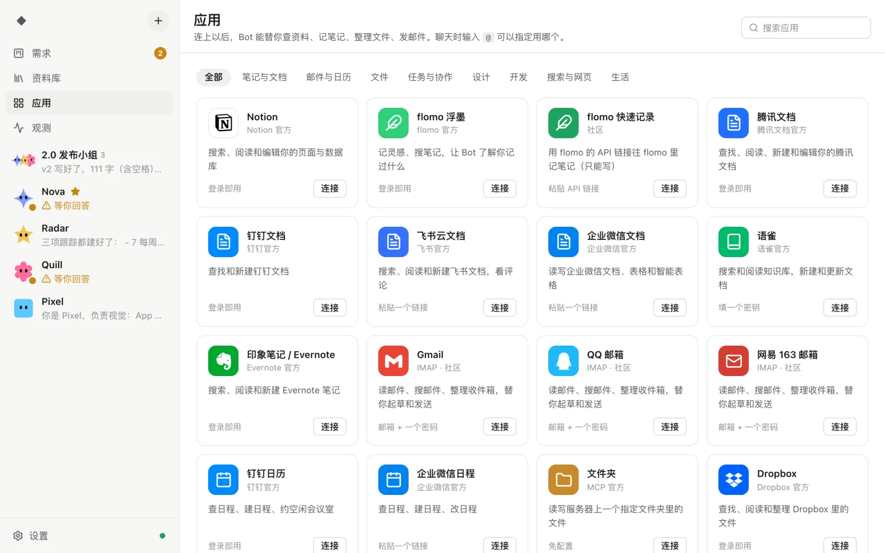

## Library, images and links

- **Library**: documents are written by you and your Bots together ([Open Agent Docs](https://github.com/kadaliao/open-agent-docs)): edit them directly, select a passage to comment and @ a Bot, and it comes to make the change and replies in the thread; undo, browse version history and restore; share a document by link for anyone to read without logging in.
  Web pages and applets the Bots make live under Web pages; browse, upload and download files on the shared computer. See [Configuration → Docs](configuration.md#文档) (Chinese).
- **Each Bot's library**: the Library tab in the side panel lists everything that Bot has handed you, newest first: pages, files it sent, images it drew and links in its replies. Filter by kind, search, open the original, and jump to the task that made it.
- **Applets**: when you need something to click (a sign-up form, a board, a calculator, a panel that looks something up, a dashboard updated daily), the Bot builds it and it shows up right in the chat.
  The page can call the Bot's tools (approval cards still appear), keep its own data (which the Bot can read and write too, so "update the board every day at 9" works), and send the Bot messages for you.
  It runs in a sandbox: it can't touch the site's data and can only do what its manifest allows.

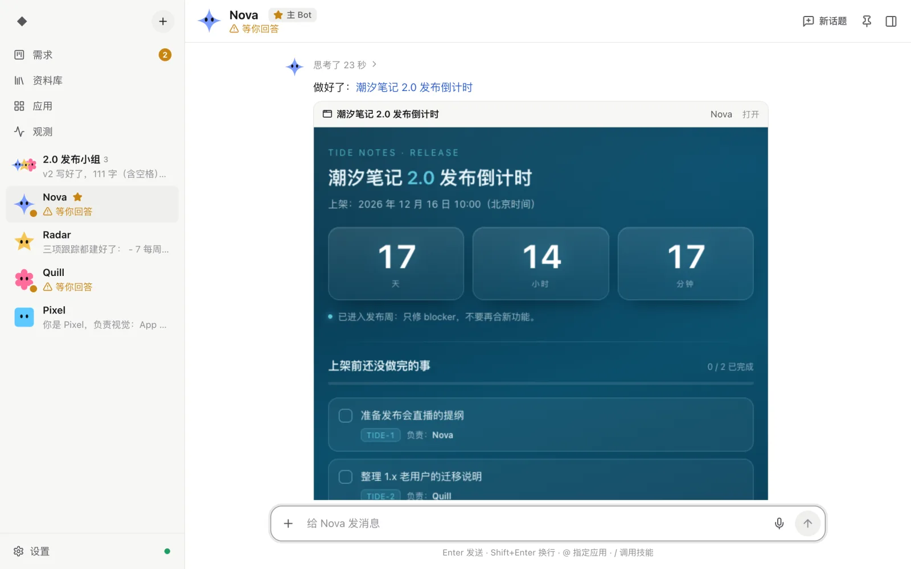

- **Images and files**:
  - Attach files in chat: images show as thumbnails, other files as cards.
  - When the chat model can see images, the Bot looks at your image directly instead of starting a task.
  - Bots can also send screenshots, spreadsheets and documents from the computer into the chat.
- **Drawing**: say "draw a ...", and the Bot first shows a card with the prompt, model and price; once you allow it, the image arrives in seconds. Download it or use it as an avatar.
  It can also draw from images: send a picture and say "make it a watercolor" or "swap the background", or ask it to keep editing the one it just drew.
- **Video**: say "make a video of ...". After you confirm, it renders in the background and a player shows up in the chat a few minutes later. It can animate an image (as the opening frame) or follow the people, products or motion in reference images and videos. Which providers it talks to is configuration, so a new model is one config entry away.
- **Link cards**: links in chat expand. YouTube and Bilibili play inline when clicked, posts on X show as embeds, and other pages show a title, summary and image.

## Routines and events

- Each Bot has its own routines: once at a set time (reminders), daily / on weekdays, on days of the month, or every N minutes.
- **Events** run when something happens instead of at a time. Sources: an incoming webhook, GitHub webhooks, a new post in a feed,
  a web page changing (or a word appearing / disappearing), a site going down, a GitHub repo getting a release or a new issue (no webhook needed),
  new email, a calendar event about to start, rain or a cold snap tomorrow, a stock / crypto / FX price crossing a line, new files in a folder,
  a background task failing, earthquakes, free Epic games, a change of public IP. Pick a ready-made use case and the form fills itself in.
  See [Events](events.md) (Chinese).
- Each event has its own webhook address, and the address is the secret, so GitHub, forms and monitoring tools can call it directly.
  Events go through keyword filters, then a cheap model decides whether to act; several at once are handled in one run, and ones that arrive mid-run are queued, not dropped.
- Pause, resume and test them; the last 20 runs are kept. Settings → Automation lists every Bot's routines and events with an on/off switch for each.
- Create one by saying "every day at 9, ..." or "tell me when this page changes". You can also just ask "what routines do I have", "move the brief to 8:30 on weekdays", "pause the github one" or "delete it", including from a chat app. The main Bot manages every Bot's routines and events ("pause all routines"); other Bots manage only their own.

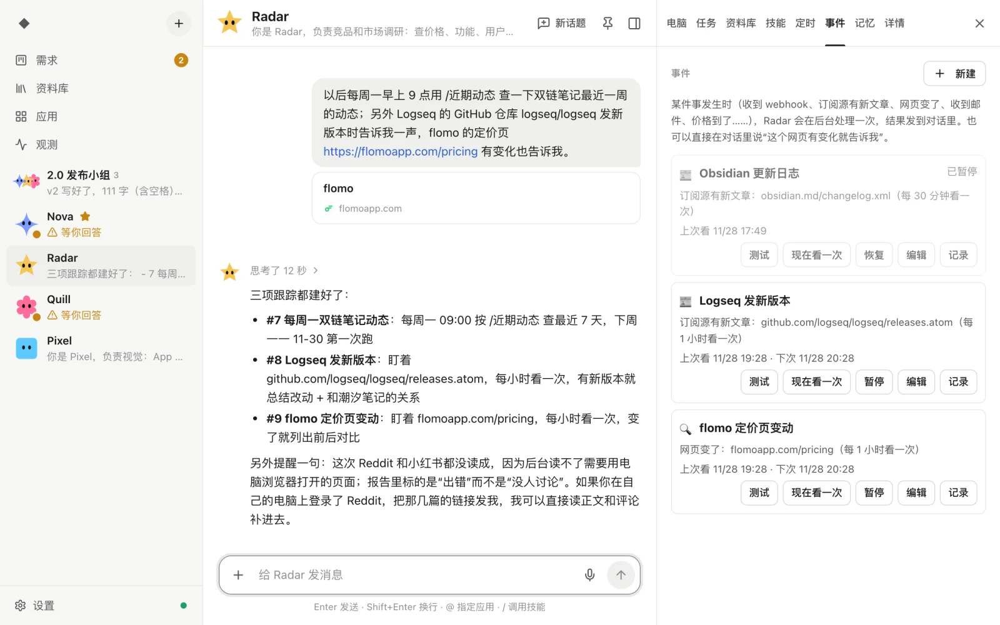

## Safety and cost

- **Asks before acting**: write operations show a card first (allow once / deny / always allow), with rules you manage in Settings.
- **Vault**: secrets are stored encrypted and never enter the chat.
- **Visible cost**: tokens and money tracked per role, task and day (see Insights), with a daily budget.
- **Insights**: the Insights page in the sidebar covers today, 7 days, 30 days or everything, for all Bots or just one:
  - Cost (compared with the previous period), tokens and cache hits, tasks with success rate and average time, routine runs, time to first word, and error counts
  - Daily (hourly for today) cost, tokens, tasks and model calls, stacked by Bot
  - Needs attention: failed and interrupted tasks plus model and tool errors, with repeats merged; click to see that task's steps
  - Tables for Bots, models (calls, errors, cost, cache hits, time to first word, tokens per second), tools (calls, errors, denials, time) and routines (runs, results, cost, with an on/off switch), a weekday × hour activity map, and recent tasks
  - A log of individual model calls you can export as CSV

  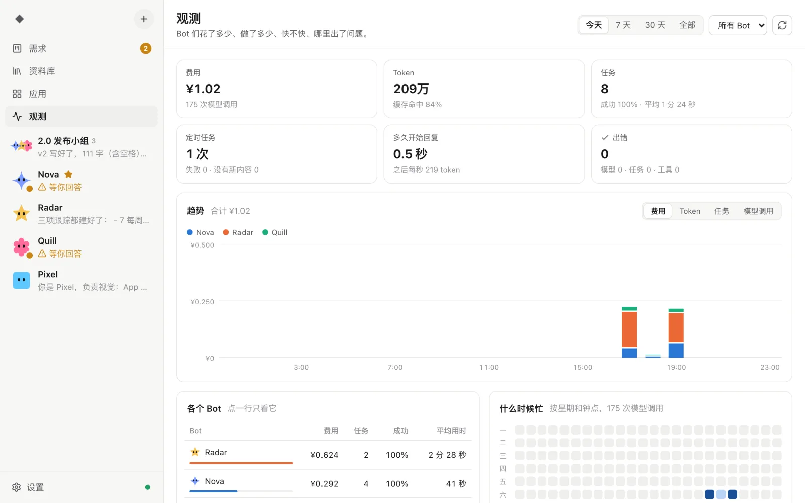
- **Watchdog**: cancels tasks that stall, loop or exceed the budget.
- **Login**: set `OSA_PASSWORD` to require a login. With or without it, other websites can't use your browser to reach the service. See [SECURITY.md](../SECURITY.md).

## Where you use it

- **Web**: any browser, desktop or phone. On a phone you can also watch the screen, take over and type, handle approvals, and dictate messages.
- **macOS desktop app**:
  - About a 40 MB download with its own runtime, no Docker or Python; Bots use this computer (a browser, plus the screen, mouse and keyboard once you grant the permissions).
  - Keeps running in the menu bar after you close the window, with system notifications for approvals and finished tasks.
  - Can also act as a client for your server. See [Desktop app](desktop.md) (Chinese).
- **iPhone app** (TestFlight): connect by scanning a QR code on your computer with the Camera; pushes go through an encrypted relay, arrive even when the app is closed, show their content on the lock screen, and open the right conversation when tapped. See [iPhone app](mobile.md) (Chinese).
- **Chat apps**: talk to your Bots from Telegram, Feishu/Lark, DingTalk, WeCom or Discord, in the same conversation as the web UI.
  - Approval requests arrive as buttons, and you can send files (and voice messages on DingTalk and WeCom).
  - When a task asks you something, the options are buttons and replying to the card (quoting it) answers it; anything else you say goes to the Bot, which tells whether it answers the question.
    A step that may or may not have gone through gets **Do it again**, **It went through** and **Stop the task**.
  - No public address needed ([setup guide](channels.md), Chinese).
- **Push notifications**: when no page is open, approvals, questions from tasks and finished tasks are pushed to your phone or computer.

## Models, languages and data

- **Any model**: add model providers in Settings (DeepSeek, OpenAI, OpenRouter, SiliconFlow, Alibaba Bailian, Zhipu, Kimi, Ollama,
  or any OpenAI-compatible endpoint), paste an API key and test it in one click. Pick a model per role; prices are fetched automatically.

  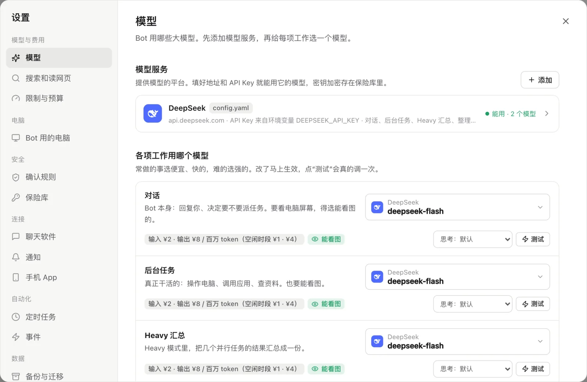
- **English and Chinese**: the UI, notifications and chat-app messages come in both languages; switch in Settings. In the English UI, Bots reply in English by default.
- **Light / dark**: follows the system by default, or pick one under "Theme" at the bottom left of Settings. Each device remembers its own choice; the desktop and iPhone apps switch their title bar and status bar too.
- **Backup and migration**: export all data, secrets included, as one encrypted file and upload it on the new machine to carry on;
  servers can also back up on a schedule from the command line.
