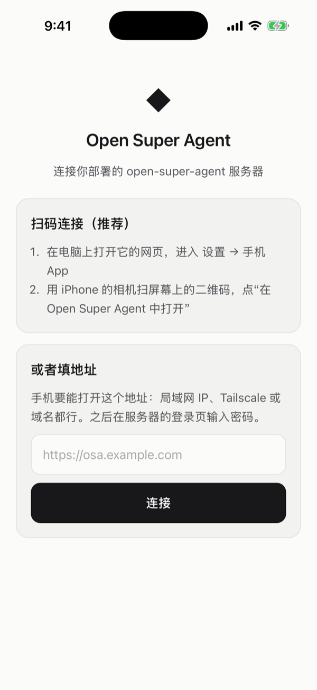
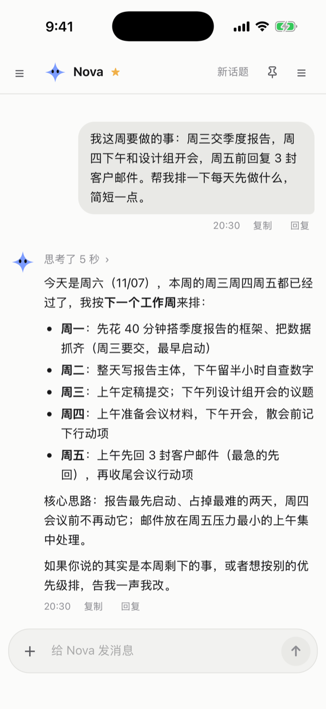
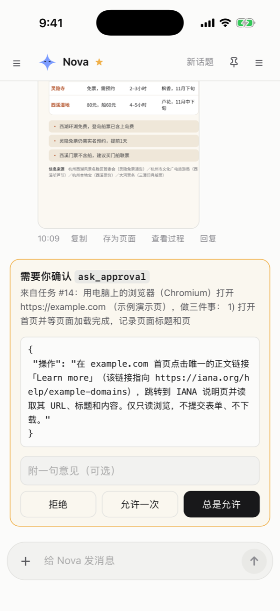
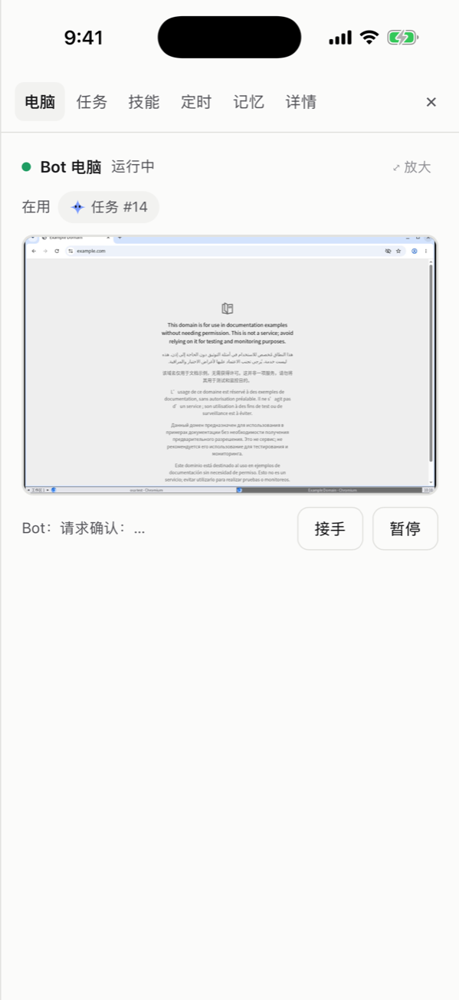

# iPhone App（TestFlight 内测）

iOS 的原生 App，用 Tauri 2 做（和桌面 App 同一套），代码在 `mobile/`。App 只是客户端：手机上不跑服务，连的是你部署好的服务器，
界面就是服务器自己的网页界面，服务器升级界面就跟着升级。

现在是 0.16.0，在 TestFlight 上内部测试，还不能公开安装。接下来是公开测试，然后上架 App Store（先上中国大陆以外的地区，中国区要先办 APP 备案）。

<p align="center">
  
  
  
  
</p>
<p align="center"><sub>连接服务器 · 对话 · 确认卡片 · 看 Bot 的电脑（模拟器上的开发版）</sub></p>

## 连接服务器

- 在电脑上打开 设置 → 手机 App，用 iPhone 的相机扫二维码，直接进 App 并登录。二维码里是服务器地址和一张 5 分钟内有效、
  只能用一次的登录票（`POST /api/pair` 发的，要先登录）；没开登录的服务器只有地址。
- 也可以在 App 里手动填地址，在服务器的登录页输密码。
- 手机要能打开这个地址：局域网 IP、Tailscale 或者自己的域名都行，`localhost` 不行。

## 推送

自己部署的服务器拿不到我们的苹果推送密钥，所以推送经过一个中转（`push.cclsp.top`，代码是 `osa/relay.py`）。
对服务器来说它就是一个普通的网页推送服务：

1. App 在中转登记手机的推送令牌，拿到一个地址 `https://push.cclsp.top/w/<随机 id>`，再在手机上生成一对加密用的密钥。
2. 地址和公钥交给服务器的 `/api/push/subscribe`，和浏览器订阅网页推送一样。
3. 服务器照常加密（RFC 8291）、签名（VAPID）后发到这个地址。中转验签名（只认登记时那台服务器的公钥）、限速，
   把密文原样转给苹果；手机上的通知扩展用自己的私钥解开后显示。

中转**看不到**通知的内容，也拿不到解密的钥匙。它看得到的是：手机的推送令牌、手机和服务器的 IP、服务器的推送公钥
（相当于一个固定编号）、推送的时间和大小。它不写访问日志，90 天没成功推送过的地址自动清掉。

开推送有两个入口：连上服务器后 App 会问一次要不要开（点了“开启”才弹系统的权限框，选“以后再说”就不再问），
之后随时可以在“设置 → 通知”里开关。在系统的权限框里点过“不允许”的，要先到 iPhone 的“设置 → 通知”里改回来。

限制：每个地址每分钟 60 条、每天 2000 条；每条加密后不超过 2900 字节（服务器的推送标题最长 80 字、正文 200 字，远小于这个）。
苹果说令牌失效时中转回 410，服务器就删掉这个订阅。

### 自己运行中转

中转绑定我们的苹果开发者账号和 App 的 bundle id，别人自己跑一个也发不到官方 App 上，所以一般不需要。
要自己打包 App 的话：

```bash
uv sync --group relay          # 连苹果要 HTTP/2（h2）
OSA_RELAY_ORIGIN=https://push.example.com OSA_RELAY_DB=/var/lib/osa-relay/relay.db \
APNS_KEY_FILE=/path/AuthKey_XXXX.p8 APNS_KEY_ID=XXXX APNS_TEAM_ID=<团队 ID> APNS_TOPIC=<bundle id> \
uv run uvicorn osa.relay:app --port 8790 --no-access-log --proxy-headers
```

systemd 和 Caddy 的配置见 `deploy/relay/`。

## 开发

要 Xcode 26、CocoaPods（`brew install cocoapods`）、Rust 的 iOS 目标（`rustup target add aarch64-apple-ios aarch64-apple-ios-sim`）。

```bash
cd mobile && npm install
npx tauri ios build --debug --target aarch64-sim     # 模拟器调试版，在 ~/Library/Developer/Xcode/DerivedData/osa-mobile-*/Build/Products/debug-iphonesimulator/
cd swift/WebPushCrypto && swift test                  # 推送解密（RFC 8291 的例子，和 osa/push.py 加密出来的一条）
cd src-tauri && cargo test --lib                      # 地址、配对链接、授权路径
```

- 目录：`src-tauri/` 是 Rust 外壳（连接页的命令、给网页界面授权、下载、扫码配对），`setup/` 是 App 自带的连接页，
  `plugin/` 是 Swift 部分（推送注册和钥匙串、弹出页、分享面板、点通知），`ios/NotificationService/` 是通知扩展，
  `swift/WebPushCrypto/` 是 App 和通知扩展共用的解密和钥匙存取。
- Xcode 工程在 `src-tauri/gen/apple/`，提交进仓库。改 `project.yml` 后在那个目录里跑 `xcodegen generate`；
  别再跑 `tauri ios init`，它会把通知扩展、权限、文案这些改动冲掉。
- 网页和 App 之间的接口是 `window.osaDesktop`（`web/src/desktop.ts`），手机版多了 `platform: 'ios'`、`push`（含只查不问的 `status()`）、`openSheet`、
  `switchServer`、`takePendingOpen`。只有服务器的网页界面（`/`、`/apps`、`/library`）能调，Bot 生成的报告页调不到。
- 要在模拟器上点系统界面（通知权限框的“允许”、锁屏、点一条通知），用 `mobile/uitest/run.sh <设备 UDID> <步骤> [文字]`，
  它是一个 XCUITest，步骤见脚本开头。真实推送的完整测法：本机起带密码的服务，App 配对后开推送（`AllowNotifications` 点掉权限框），
  `Lock` 锁屏，服务器发推送（`/api/push/test`，或者在“没在看”的页面里给 Bot 发消息），看 `last-push.json` 和截图，
  再 `TapNotification <标题>` 点横幅，确认打开了对应的对话。模拟器锁屏上点通知还要上滑解锁，不会转给 App，这一步只能在真机上试。
- 调试版留了自动测试的通道（正式版里没有）：
  - 启动参数 `--osa-open <链接>`：当成打开了这个链接，比如 `opensuperagent://pair?u=…&t=…`；
  - 启动参数 `-OSAAutotest YES`：开推送时用不弹窗的临时授权；`-OSARelay http://127.0.0.1:8790` 换成本机的推送中转；
  - 往 App 的 `Documents/autotest.js` 里写 JS，App 会在页面里执行它（`xcrun simctl get_app_container <设备> com.kadaliao.opensuperagent data`）；
  - 通知扩展把最后一条推送的解密结果写进 App Group 的 `last-push.json`。`simctl push` 不会调用通知扩展，要用苹果的 sandbox 推送才行。

## 发布（TestFlight / App Store）

在这台 Mac 上打包上传，还没有 CI：

```bash
mobile/scripts/release-ios.sh <构建号>            # 打包、导出 ipa、检查权限和版本号、altool validate
mobile/scripts/release-ios.sh <构建号> --upload   # 再上传到 App Store Connect，处理完自动发给 TestFlight 的 Internal 组
```

- 版本号跟着 `mobile/package.json`（和服务端、桌面版一样）；构建号每次上传都要加 1，同一个版本号下不能重复。
- 签名用手动方式：Apple Distribution 证书（从钥匙串导进一个临时钥匙串，打完就删）和两份 App Store 描述文件
  “Open Super Agent App Store”“Open Super Agent NotificationService App Store”，写在 `gen/apple/project.yml` 的 release 配置里，
  导出用 `mobile/scripts/ExportOptions-appstore.plist`。描述文件 2027-11-07 到期，到期前在开发者网站重新生成并装到本机。
- 上传用 App Store Connect API key（Developer 角色就够上传）。打包时不要设 `APPLE_API_*`：Tauri 会改用自动签名，通知扩展的权限会丢。
